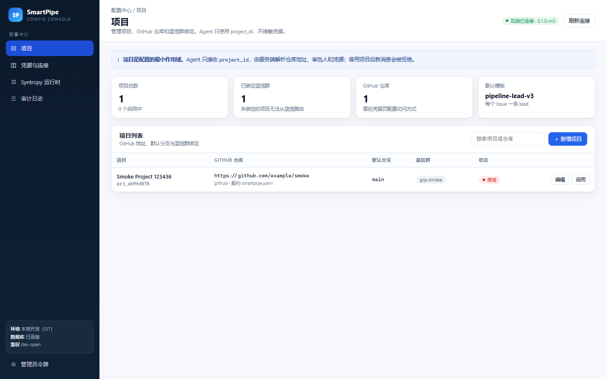
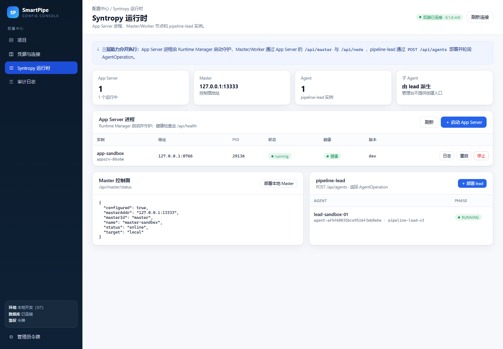
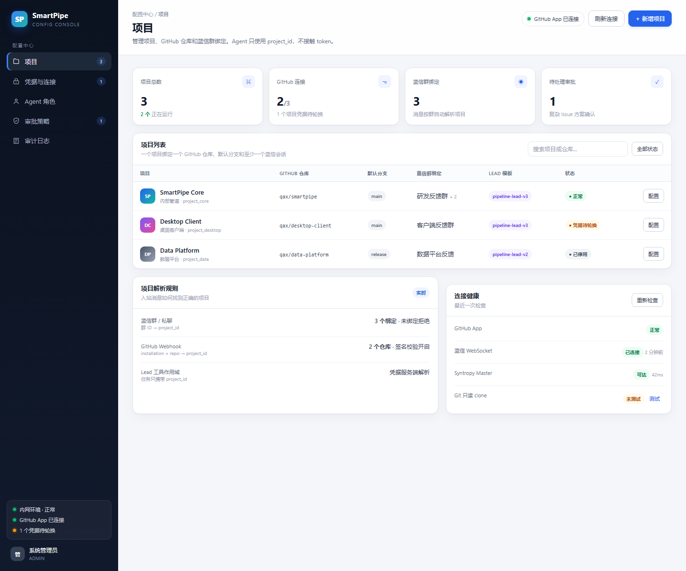
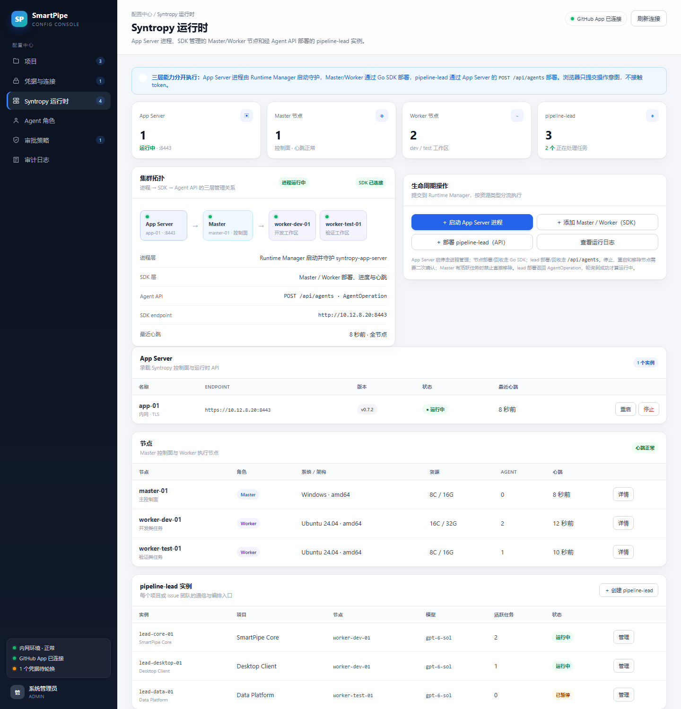
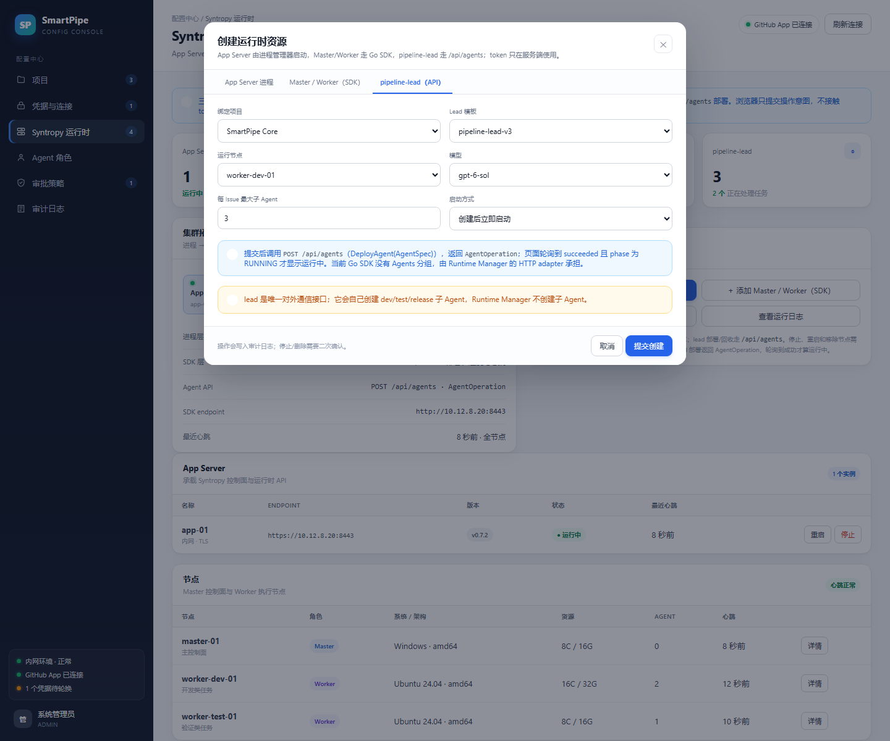

# SmartPipe

以 GitHub Issue 为工作项、由 Agent 驱动的自动化开发-测试-发版管道。

## 目标架构

```
蓝信反馈
  → bot ingress（验签、去重、用户身份）
  → GitHub Issue（唯一工作项与讨论事实源）
  → pipeline-lead（分诊、判断复杂度、自己创建子 Agent、唯一对外接口）
      ├─ dev 子 Agent：修改 + 自测
      ├─ test 子 Agent：干净副本独立验证
      └─ release 子 Agent：构建、发布、回滚
  → lead 在干净副本做最终验证、提交、合并
  → 蓝信通知用户
```

关键约束：

- 复杂 Issue 必须先在 GitHub Issue 评论区讨论，并由有权限的维护者 `/approve vN` 确认具体方案版本，才允许进入开发。
- 不使用 GitHub Actions。dev/test 在各自工作区测试，lead 负责最终验证、提交和合并。
- 内部不再维护完整的第二套 Issue 服务；只保留蓝信 ↔ GitHub ↔ Syntropy 的薄桥接、审批记录和审计。
- lead 是系统通信的唯一接口；我们的桥接代码不创建子 Agent，子 Agent 由 lead 自己创建。
- 项目、GitHub 地址、蓝信和 Syntropy 凭据统一在配置管理台维护；凭据加密存储，Agent 不读取明文。
- Agent 负责判断和协调；验签、去重、持久化、权限、补丁校验、提交、签名和审计由受控服务/工具执行。
- Syntropy Go SDK 是 App Server 的客户端：App Server 进程由 Runtime Manager 启动，Master/Worker 用 SDK 管理，pipeline-lead 用 App Server 的 `/api/agents` 部署。

设计基线：[docs/自动化开发-测试-发版管道设计方案.md](docs/自动化开发-测试-发版管道设计方案.md)

## 当前代码状态

M0–M4 已在本地环境跑通（Windows + 192.168.1.99 上的 Postgres，Linux Docker 用于交叉验证）：

| 阶段 | 内容 | 入口 | 记录 |
|---|---|---|---|
| M0 | 配置管理台：项目、凭据（AES-256-GCM）、连接测试、Syntropy 运行时（App Server/Master/Worker/lead） | `backend/cmd/admin-api`、`web/` | [M0](docs/M0实施记录.md) |
| M1 | 蓝信 → GitHub Issue 桥接、Webhook 验签与去重、lead 派单与回执 | `backend/cmd/bridge`、`backend/cmd/bot` | [M1](docs/M1实施记录.md) |
| M2 | 无 Actions 的补丁门禁：干净副本 + `smartpipe.yaml`、失败回路、`/commit`、`/push` | `backend/cmd/patch-verifier` | [M2](docs/M2实施记录.md) |
| M3 | 复杂 Issue 方案登记、`/approve vN` 权限与哈希校验、派生入口强制门禁 | `/admin/derivations` | [M3](docs/M3实施记录.md) |
| M4 | 发版链路：候选 Issue → 构建 → tag/Release → 标签回写 → 蓝信通知 → 回滚 | `/admin/releases/runs` | [M4](docs/M4实施记录.md) |
| 崩溃上报 | `crash_bundle` 脱敏、指纹去重、限流、自动建单与派单 | `POST /ingest/crash` | [崩溃上报](docs/崩溃上报实施记录.md) |
| MCP 网关 | Agent 令牌（角色/项目绑定）、工具裁剪、Issue/验证/派生/发版工具；已接入 Syntropy MCP Pool 与 Agent 环境注入；调用审计落库，MCP 地址/池名可在「工具调用」页维护 | `backend/cmd/mcp-gateway`（:8097/mcp） | [MCP 网关](docs/MCP工具网关实施记录.md) |

重构方向：

- 保留 `backend/cmd/bot` 作为蓝信入口；`bridge` 只做消息 ↔ Issue 的薄桥接与派单。
- `orchestrator` / `issue-service` 是早期原型，不再扩展为主方案路径。
- `pipeline-lead` 由 lead 自己派生 `dev` / `test` / `release` 子 Agent；我们的服务只提供派生与门禁接口。
- 所有外部凭据由配置管理台托管，Agent 只拿到 `project_id`。
- MCP 收敛为一个 smartpipe-mcp，内部按 GitHub/issue/patch/verify/release 分组。

## 本地原型

```powershell
# 1) Issue 原型服务（内存存储）
Set-Location backend; go run ./cmd/issue-service

# 2) 编排原型
$env:ISSUE_SERVICE_URL = 'http://127.0.0.1:8092'
$env:BOT_URL = 'http://127.0.0.1:8091'
$env:INTERNAL_TOKEN = 'dev-token'
go run ./cmd/orchestrator

# 3) 蓝信机器人（凭证见 deploy/bot.local.env）
$env:ORCHESTRATOR_URL = 'http://127.0.0.1:8090'
$env:INTERNAL_TOKEN = 'dev-token'
go run ./cmd/bot
```

原型验证：`cd backend; go test ./...`。蓝信连通性自检：`go run ./cmd/botdiag`。

## 配置管理台（已可运行）

`web/` 是 React + Vite 实现的配置中心，接真实管理 API：

- 项目：GitHub 仓库、默认分支、蓝信群绑定、验证契约、lead 模板
- 凭据与连接：AES-256-GCM 密文存储、掩码展示、轮换、服务端连接测试
- Syntropy 运行时：启动/停止 App Server、部署 Master、加入 Worker、部署 pipeline-lead
- 审计日志：操作人、动作、目标、trace_id





启动方式与环境变量见 [M0 实施记录](docs/M0实施记录.md)。

## 配置中心静态 Demo


[打开可点击的 HTML Demo](web/config-demo.html)





运行时页面支持 App Server 进程、Master/Worker 节点和 pipeline-lead 实例：[打开运行时页面](web/config-demo.html#runtime)。



## 文档

- [主设计方案 v0.7.2](docs/自动化开发-测试-发版管道设计方案.md)
- [复杂 Issue 讨论与确认流程](docs/复杂Issue讨论与确认流程.md)
- [无 GitHub Actions 的 Agent 开发测试方案](docs/无GitHub-Actions的Agent开发测试方案.md)
- [GitHub Issue 驱动架构](docs/GitHub-Issue驱动架构.md)
- [集中配置管理台设计](docs/集中配置管理台设计.md)
- [Syntropy 运行时管理设计](docs/Syntropy运行时管理设计.md)
- [下一步实施计划](docs/下一步工作计划.md)
- [开发计划与测试环境方案](docs/开发计划与测试环境方案.md)
- [M0 实施记录](docs/M0实施记录.md)
