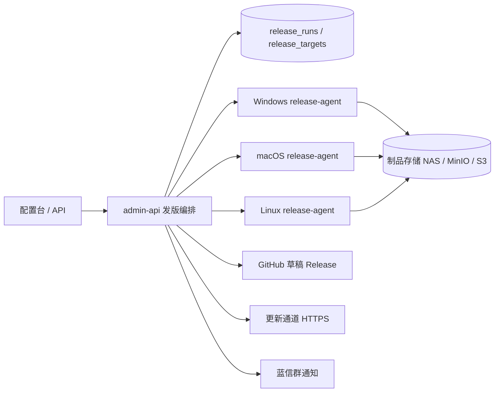

# Electron 跨平台发版设计（Windows / macOS / Linux）

更新时间：2026-11-11

适用范围：SmartPipe 管理的 Electron 桌面端项目

## 结论

当前 release 功能是“一台机器执行一条 `smartpipe.yaml` 构建命令，再收集一组 `dist/**` 制品”的模型。Electron 桌面端要同时发布 Windows、macOS、Linux，继续沿用这个模型会遇到三个硬限制：

- macOS 的签名、公证和 Gatekeeper 验收必须在 macOS 上完成，不能靠 Windows 或 Linux 交叉构建替代；
- 三个平台的安装包格式、架构和自动更新元数据不同，不能用同一组制品 glob 混在一起；
- 任一平台构建或签名失败时，不应该先创建 GitHub Release，否则用户可能下载到不完整的版本。

建议改成“控制面 + 三台构建代理”的结构：

- GitHub 只保留代码、Issue、评论、PR 和 Release 元数据，不跑构建；
- `admin-api` 负责编排发版任务、汇总结果和发布门禁；
- Windows、macOS、Linux 各一台 `release-agent`，主动拉取任务，在干净副本上构建、签名、验证并上传制品；
- 所有必选平台通过后，才创建草稿 Release、上传资产并发布；
- 自动更新使用独立的通道文件，回滚时先切回旧版本通道，而不是只删除 Release。

最小可落地组合：一台 Mac mini、一台 Windows 小主机、一台 Linux 虚拟机，加 NAS 或 MinIO。硬件一次性投入约 1.3 万至 2.3 万元，具体取决于是否复用现有服务器和 NAS。

## 1. 现有实现的差距

| 现有实现 | Electron 发版需要 |
|---|---|
| `release.Build` 在 `admin-api` 所在机器执行一条 `commands.build` | 每个目标平台单独执行构建命令 |
| 一个仓库只有一组 `artifact_globs` | 每个平台、架构、安装包格式分别收集制品 |
| 构建完成后立即创建 tag 和 GitHub Release | 先创建草稿 Release，全部必选目标通过后再发布 |
| 没有 `smartpipe:ready` Issue 时直接 `skipped` | 桌面端支持按 tag 或手动触发，增加 `allow_empty_candidates` |
| 只校验 manifest 的 HMAC | 校验 Apple 签名与公证、Windows Authenticode 签名、Linux 校验和 |
| 默认 10 分钟构建超时 | 单目标 30 至 60 分钟，macOS 公证可能更久 |
| 回滚删除 Release 与 tag | 回滚更新通道指针，保留制品和审计记录 |
| 单平台制品名直接作为 Release 附件名 | 按目标前缀命名，避免 `latest.yml`、安装包同名冲突 |

## 2. 推荐架构



构建代理只向控制面发起出站 HTTPS/mTLS 连接，不开放入站端口，适合放在办公室或内网 NAT 后面。控制面给每个任务下发短期凭据；构建代理不持有推送权限，只拿只读克隆权限和当前任务需要的签名材料。

## 3. 平台矩阵

建议第一版先做四个目标，覆盖主流用户：

| 目标 | 构建机 | 主要产物 | 必做校验 |
|---|---|---|---|
| `windows-x64` | Windows 11 | NSIS `.exe`、`.blockmap`、`latest.yml` | Authenticode 签名、时间戳、`signtool verify` |
| `macos-arm64` | Apple Silicon Mac | `.dmg`、`.zip`、`latest-mac.yml` | Developer ID 签名、公证、staple、Gatekeeper |
| `macos-x64` | Intel Mac 或同一台 Mac 交叉构建 | `.dmg`、`.zip` | 同上 |
| `linux-x64` | Ubuntu 22.04/24.04 | AppImage、`.deb`、`latest-linux.yml` | SHA-256；可选 GPG |

后续按用户分布增加：

- `windows-arm64`：有 ARM Windows 用户时再加；
- `linux-arm64`：有 ARM 服务器或国产化终端时再加；
- `rpm`：目标客户使用 RHEL/CentOS 系时再加；
- macOS universal：只维护一个安装包时使用，体积更大，构建和公证更慢。

如果只有一台 Mac，建议顺序构建 `arm64` 和 `x64`，先不要做 universal。若应用包含原生 Node 模块，必须在对应架构上构建或准备对应工具链，不能假设 x64 产物可以直接给 arm64 使用。

## 4. 发布流程

1. 在配置台选择项目、commit、版本号、发布通道和目标平台。
2. `admin-api` 创建一次 `release_run`，为每个目标创建独立任务。
3. 每个 `release-agent` 拉取任务，干净克隆指定 commit，校验提交哈希，执行 `npm ci` 和目标平台构建。
4. 构建完成后执行平台校验：Windows 验签，macOS 验签并公证，Linux 校验 checksum；再运行最小启动测试。
5. 代理上传安装包、blockmap、更新元数据、`SHA256SUMS`、`manifest.json` 和 SBOM。
6. 控制面检查所有必选目标均为成功；有任一失败就不创建 tag 和 Release，只在运行记录里保留失败日志。
7. 创建草稿 GitHub Release，上传全部资产，确认资产数量和校验和后再发布。
8. 更新 `stable.json` / `beta.json` 等通道文件，把新版本、下载地址和 SHA-256 写进去。
9. 通知蓝信群，并在候选 Issue 上回写发布结果。
10. 回滚时先把通道文件切回上一版本，再把当前 Release 标记为 yank 或 prerelease；制品保留一段时间用于审计和客户支持。

草稿 Release 是关键。当前代码在构建完成后直接创建公开 Release，再逐个上传附件；多平台发布不能沿用这个顺序，否则中途失败会留下一个缺文件的公开版本。

## 5. 签名与公证

### 5.1 Apple

macOS 分发到 App Store 之外，必须准备：

- Apple Developer Program 组织账号，年费约 99 美元；
- Team ID；
- Developer ID Application 证书；
- App Store Connect API Key（`.p8`、Key ID、Issuer ID），用于自动公证；
- 应用 Bundle ID、图标、隐私说明和必要的 entitlements；
- 启用 hardened runtime，使用 `notarytool` 公证并 `stapler` 装订票据。

构建配置示例：

```yaml
mac:
  hardenedRuntime: true
  gatekeeperAssess: false
  entitlements: build/entitlements.mac.plist
  entitlementsInherit: build/entitlements.mac.plist
  notarize: true
```

构建后至少执行：

```bash
codesign --verify --deep --strict --verbose=2 "Syntropy.app"
spctl -a -vv "Syntropy.app"
xcrun stapler validate "Syntropy.app"
```

没有 Apple 开发者账号就无法完成正式公证。公证需要 macOS 构建机联网访问 Apple 服务；内网环境要提前配置代理和出站白名单。

### 5.2 Windows

Windows 需要代码签名证书，建议优先 EV 证书：

- EV 证书通常放在 USB Token 或 HSM 中，不能导出成普通 PFX；
- OV 证书成本更低，可以导出 PFX，但 SmartScreen 信誉需要时间积累；
- 也可以使用 Azure Trusted Signing、DigiCert KeyLocker 等云签名服务，避免在多台构建机之间搬运 Token。

至少签名主程序和安装包，并使用 SHA-256 时间戳。构建后执行：

```powershell
signtool verify /pa /v dist\Syntropy-Setup.exe
```

如果使用 EV Token，Windows 构建机要固定放置 Token，并限制登录权限；如果使用云签名，构建机需要能访问签名服务。

### 5.3 Linux

Linux 没有 macOS 那样的系统级公证要求。最低要求是生成 `SHA256SUMS` 并在发布页展示；如果做 apt/yum 仓库，建议用 GPG 对仓库元数据签名，并公布公钥。AppImage 和 deb 至少要在干净的 Ubuntu 环境启动一次。

### 5.4 密钥管理

- 证书、私钥、Apple API Key、Token 密码只在 `admin-api` 加密保存，构建代理按任务短期获取；
- 构建日志禁止打印证书内容、密码和完整环境变量；
- 构建代理使用只读克隆凭据，不授予 push 权限；
- 签名材料定期轮换，离职或换机时立即吊销旧证书；
- 发布审计记录签名人、证书指纹、公证结果和制品 SHA-256。

## 6. 硬件清单

### 6.1 最小可用配置

| 设备 | 建议配置 | 数量 | 用途 | 参考价（人民币） |
|---|---|---|---:|---|
| macOS 构建机 | Mac mini M4，16 GB 内存，512 GB SSD | 1 | macOS 构建、签名、公证、Gatekeeper 验收 | 5,000–6,500 |
| Windows 构建机 | 迷你主机，8 核 16 线程，32 GB 内存，1 TB NVMe，Windows 11 Pro | 1 | Windows 安装包构建、签名、安装测试 | 4,000–6,000 |
| Linux 构建机 | 8 vCPU，16 GB 内存，200 GB SSD 的虚拟机 | 1 | AppImage/deb/rpm 构建 | 0–4,000 |
| 制品存储 | NAS 4 TB RAID1，或现有服务器上的 MinIO | 1 | 保存安装包、日志、校验和、SBOM | 3,000–5,000 |
| UPS 与网络 | 1 kVA UPS、千兆交换机、有线网络 | 1 套 | 防止构建中断，保证上传稳定 | 1,000–2,000 |
| 测试设备 | Windows 10/11、Intel Mac、Apple Silicon Mac、Ubuntu 虚拟机 | 按现有条件 | 安装包启动和升级验收 | 0–10,000 |

不含测试设备时，一次性投入约 1.3 万至 2.3 万元。已有 Linux 服务器或 NAS 时，可降到约 0.9 万至 1.4 万元。

### 6.2 什么时候需要升级

- 每周多次发版、需要并行构建：再加一台 Mac mini，或把 Mac 换成 M4 Pro、24 GB 内存、1 TB SSD；后者参考价约 1 万元。
- 同时构建 universal 包：建议 24 GB 以上内存，16 GB 会比较紧张。
- Windows 同时跑多个 Electron 打包任务：32 GB 内存是底线，64 GB 更稳。
- 构建产物保留超过 20 个版本：NAS 用 4 TB RAID1，或接入对象存储并设置生命周期规则。

### 6.3 硬性限制

- macOS 构建机必须是 Apple 真机；不要用非 Apple 硬件上的 macOS 虚拟机，也不要把签名公证放到 Windows/Linux 上。
- Mac mini 16 GB 可以顺序构建 arm64 和 x64，适合中小型 Electron 应用；大型应用或 universal 包建议 24 GB 以上。
- 单次 Electron 构建常占用 5–15 GB 磁盘，1 TB 本地盘比 256 GB 更合适。
- 构建机要关闭自动睡眠，固定有线网络，配置 UPS；macOS 公证和 Windows 签名都怕中途断网。

### 6.4 云端备选

如果暂时不想买 Mac，可以用 MacStadium、AWS EC2 Mac 等托管 Mac 做过渡，按月或按小时计费。它们适合临时验证和发布高峰期，但长期成本通常高于自购 Mac mini。GitHub 托管的 macOS Runner 也按分钟计费，而且私有仓库的 macOS 分钟倍率较高；发版频率一高，自建 Mac 更容易摊平成本。

## 7. 账号与年费

| 项目 | 用途 | 参考费用 | 前置时间 |
|---|---|---|---|
| Apple Developer Program | Developer ID 证书、公证 | 约 99 美元/年 | 1–3 个工作日，组织账号可能需要 D-U-N-S |
| Windows 代码签名证书 | Authenticode 签名、SmartScreen | 约 200–700 美元/年 | 3–10 个工作日，EV 需要 Token |
| 域名与 CDN | 更新通道、安装包下载 | 约 100–500 美元/年 | 按备案和 DNS 流程 |
| Linux GPG | apt/yum 仓库签名 | 免费 | 当天 |
| GitHub | 代码、Issue、Release 元数据 | 使用现有套餐 | 无 |

Apple 开发者账号和 Windows 证书是长周期项，建议先启动申请。硬件可以边采购边做构建脚本和签名验证。

## 8. SmartPipe 需要改什么

### 8.1 扩展 `smartpipe.yaml`

保留现有 `commands` 给补丁验证使用，新增 `release.targets`：

```yaml
version: 1
commands:
  build: npm run build
  test: npm test
required_for_merge: [build, test]

release:
  version_from: package.json
  required_targets: [windows-x64, macos-arm64, linux-x64]
  targets:
    windows-x64:
      os: windows
      arch: x64
      build: npm ci && npm run build && npx electron-builder --win nsis --x64 --publish never
      verify: powershell -File scripts/verify-win.ps1
      artifacts:
        - dist/*.exe
        - dist/*.blockmap
        - dist/latest.yml
      signing: windows
    macos-arm64:
      os: macos
      arch: arm64
      build: npm ci && npm run build && npx electron-builder --mac dmg zip --arm64 --publish never
      verify: bash scripts/verify-mac.sh
      artifacts:
        - dist/*.dmg
        - dist/*.zip
        - dist/latest-mac.yml
      signing: apple
      notarize: true
    linux-x64:
      os: linux
      arch: x64
      build: npm ci && npm run build && npx electron-builder --linux AppImage deb --x64 --publish never
      verify: bash scripts/verify-linux.sh
      artifacts:
        - dist/*.AppImage
        - dist/*.deb
        - dist/latest-linux.yml
      signing: none
```

约定：

- `commands.build` 只负责编译和单元测试，供 PR 验证使用；
- `release.targets.<id>.build` 负责安装依赖和打包，允许更长时间；
- `artifacts` 只列安装包、blockmap、更新元数据和校验文件，不把 `win-unpacked/`、`mac/`、`linux-unpacked/` 整目录上传；
- `verify` 是平台验收脚本，失败则该目标失败；
- `required_targets` 决定发布门禁，缺一个就不发布。

### 8.2 数据模型

现有 `release_runs.artifacts` JSON 可以继续保留用于兼容，但多平台需要拆出目标表：

```sql
release_runs (
  id, project_id, version, commit_sha, branch, channel,
  status, trigger, candidates, notes, release_url, tag, release_id,
  manifest_sha256, output_dir, error, notify_status,
  started_at, finished_at, duration_ms
)

release_targets (
  id, run_id, target, os, arch, status, worker_id,
  build_command, verify_command, log, error,
  started_at, finished_at, duration_ms
)

release_artifacts (
  id, run_id, target_id, kind, name, size, sha256,
  storage_key, download_url, signature_status, notarization_status
)

build_workers (
  id, os, arch, labels, status, version, heartbeat_at, last_error
)

release_channels (
  project_id, channel, version, metadata_url, updated_at
)
```

`kind` 建议取 `installer`、`blockmap`、`update-metadata`、`checksum`、`sbom`、`symbols`，方便控制台按类型展示和校验。

### 8.3 API

```http
POST /admin/releases/runs
{
  "project_id": "prj_xxx",
  "version": "v1.2.3",
  "commit": "abc1234",
  "channel": "stable",
  "targets": ["windows-x64", "macos-arm64", "linux-x64"],
  "dry_run": false
}

GET  /admin/releases/runs/{id}/targets
POST /admin/releases/runs/{id}/retry-target
POST /admin/releases/runs/{id}/cancel
POST /admin/releases/runs/{id}/publish
POST /admin/releases/runs/{id}/rollback
```

`publish` 与 `rollback` 分开，避免“构建完成”被误认为“已经对外发布”。`dry_run` 只构建、签名和校验，不创建 tag、不发布 Release、不切通道。

### 8.4 控制台

当前发版页只有一个“制品 glob”和一个“构建并发布”按钮。多平台版本建议改成：

- 目标平台复选矩阵：Windows x64、macOS arm64、macOS x64、Linux x64；
- 每个目标一张状态卡：排队、构建、签名、公证、验证、上传、成功、失败；
- 每个目标可单独查看日志、重试、取消；
- 签名和公证用独立徽标展示，失败原因直接可读；
- “发布”按钮只在 `required_targets` 全部成功时可用；
- 制品表显示文件名、平台、架构、大小、SHA-256、签名状态和下载链接；
- 回滚时选择通道，展示当前通道指针和目标回退版本。

### 8.5 代码层改动

1. 把 `release.Build` 拆成控制面编排和平台代理执行两部分；
2. 新增 `release-agent` 二进制，按 `GOOS` 编译到三个平台；
3. `release.Execute` 先创建运行记录和目标任务，全部成功后再创建草稿 Release；
4. `github.CreateRelease` 增加 `draft`、`prerelease`、`make_latest` 参数；
5. 附件名加目标前缀，例如 `windows-x64/Syntropy-Setup.exe`，避免不同平台同名；
6. 每个目标独立超时、重试和取消，默认 60 分钟；
7. 回滚改为切换 `release_channels` 指针，并把旧 Release 标记为 yank；
8. 保留现有单目标构建路径，非 Electron 项目不受影响。

## 9. 自动更新与回滚

Electron 建议使用 `electron-updater`，发布 `latest.yml`、`latest-mac.yml`、`latest-linux.yml` 和对应 blockmap。更新源可以用自有 HTTPS 域名，GitHub Release 作为镜像。

GitHub Release 单个附件通常有 2 GB 上限；安装包更大时改用 MinIO、S3 或 OSS，GitHub 只保留 Release 说明和校验文件。

通道文件示例：

```json
{
  "channel": "stable",
  "version": "v1.2.3",
  "released_at": "2026-11-11T10:00:00Z",
  "artifacts": {
    "windows-x64": {
      "url": "https://download.example.com/Syntropy-1.2.3-win-x64.exe",
      "sha256": "..."
    },
    "macos-arm64": {
      "url": "https://download.example.com/Syntropy-1.2.3-mac-arm64.dmg",
      "sha256": "..."
    }
  }
}
```

回滚只切通道指针，不立刻删除旧安装包。已经下载新版本的用户无法通过服务端强制回退，但新用户和自动更新检查会立即拿到旧版本；旧 Release 保留为 yank 状态，便于审计和客服排查。

macOS 和 Windows 的自动更新都要求应用已签名。Linux 的 AppImage 可以用 electron-updater，deb/rpm 需要配合系统包仓库或独立更新器。

## 10. 验证与安全

每个目标至少执行：

- 干净克隆指定 commit，校验 SHA；
- `npm ci`，使用 lockfile；
- 构建和平台打包；
- 安装包内容检查，确认没有 `node_modules` 源码、测试文件和开发证书；
- Windows `signtool verify /pa`；
- macOS `codesign`、`spctl`、`stapler validate`；
- Linux `sha256sum -c`，可选 `gpg --verify`；
- 最小启动测试：安装后启动应用，检查主窗口和版本号；
- 生成 SBOM 和 `SHA256SUMS`。

构建代理要满足：

- 只接受控制面任务，使用 mTLS 或短期令牌；
- 每个任务使用临时工作目录，任务结束清理；
- 不共享 `node_modules`，避免平台差异污染；
- 日志脱敏，证书和密码不落盘；
- 磁盘加密，构建机专人管理；
- 代理心跳和任务超时告警。

## 11. 分阶段实施

### 阶段 0：准备（约 1 周）

- 申请 Apple Developer Program 和 Windows 代码签名证书；
- 采购 Mac mini 和 Windows 构建机，准备 Linux 虚拟机；
- 在三个平台手工跑通 `npm ci`、`electron-builder` 和签名；
- 确认 Bundle ID、应用图标、最低系统版本和更新域名。

### 阶段 1：三平台可构建（约 1–2 周）

- 新增 `release-agent`，Windows 和 Linux 先接入；
- 控制台支持目标矩阵和每目标日志；
- 产物上传到 NAS/MinIO，生成 SHA-256 和 manifest；
- 实现草稿 Release 和全目标通过后发布。

### 阶段 2：macOS 签名与公证（约 1 周）

- 接入 Developer ID 证书和 App Store Connect API Key；
- 配置 hardened runtime 和 entitlements；
- 公证、staple、Gatekeeper 验收；
- 接入 macOS 目标的签名状态展示和失败重试。

### 阶段 3：自动更新与运维（持续）

- 通道文件和灰度发布；
- 回滚演练；
- arm64 目标；
- 构建缓存、并行和成本监控；
- 崩溃上报、版本采用率和更新失败率看板。

验收标准：

- 一个版本能同时产出 Windows、macOS、Linux 安装包；
- 任一必选目标失败时不会创建公开 Release；
- macOS 安装包在干净 Mac 上通过 Gatekeeper；
- Windows 安装包通过 `signtool verify`，并在干净 Windows 上完成安装和启动；
- Linux AppImage/deb 在干净 Ubuntu 上启动；
- 回滚后新客户端检查更新能在 5 分钟内拿到上一版本；
- 审计记录能查到 commit、目标平台、签名证书、公证结果和每个制品的 SHA-256。

## 12. 需要你提供或确认的内容

1. 目标矩阵：Windows 是否只要 x64；macOS 要 arm64、x64 还是 universal；Linux 要 AppImage、deb、rpm 中的哪些；是否需要 arm64。
2. Electron 打包工具：electron-builder 还是 electron-forge；仓库路径和现有打包脚本。
3. Apple 开发者账号状态、Team ID、Developer ID 证书、App Store Connect API Key 是否已有。
4. Windows 代码签名证书类型：EV、OV 还是云签名；是否有 USB Token。
5. 现有硬件：是否有 Mac mini、Windows 构建机、Linux 服务器或 NAS。
6. 更新通道域名和制品存储方式：GitHub Release、MinIO、S3/OSS 还是 CDN。
7. 发版频率和最大并行构建数，用于确定 Mac 内存和是否加第二台 Mac。
8. 是否包含原生 Node 模块，以及需要支持的最低 Windows、macOS、Ubuntu 版本。
9. 谁负责批准发布、谁保管证书和 Token。
10. 是否需要上架 Mac App Store；如果需要，证书、沙箱和审核流程要单独设计。

其中 Apple 开发者账号和 Windows 证书是长周期项，建议先启动。其余事项可以先用默认方案推进：Windows x64、macOS arm64 + x64、Linux x64 AppImage + deb，制品存 MinIO，更新走独立 HTTPS 通道。
