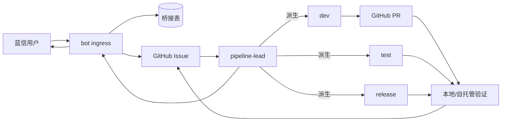

# GitHub Issue 驱动的 Agent 修复系统

日期：2026-11-05

> 当前约束：不使用 GitHub Actions。测试由 dev/test 子 Agent 在各自工作区执行，lead 在干净副本做最终验证、提交和合并。详见 [无GitHub-Actions的Agent开发测试方案.md](无GitHub-Actions的Agent开发测试方案.md)。

## 1. 定位

这套系统的本质是：

> 蓝信负责收集反馈，GitHub Issue 负责承载工作项和讨论，Syntropy Agent 负责判断与修复，GitHub PR 承载改动与评审，本地/自托管验证负责测试，lead 负责最终合并和提交。

GitHub Issue 是唯一的工作项事实源。内部不再维护另一套完整的 Issue CRUD、编号体系和状态机 UI；只需要一个很薄的桥接层，负责蓝信消息与 GitHub Issue 的映射、幂等、审批记录和审计。

系统边界可以概括为：

| 部分 | 角色 |
|---|---|
| 蓝信机器人 | 用户入口、消息通知、追问和结果回传 |
| GitHub Issue | 问题描述、讨论、方案确认、状态标签、责任人和发布批次 |
| `pipeline-lead` Agent | 分诊、判断复杂度、**自己创建子 Agent**、推进状态、唯一对外沟通接口 |
| `dev` / `test` / `release` 子 Agent | 按需执行代码、测试、发布子任务 |
| GitHub PR | 代码改动、评审、验证摘要和合并记录 |
| 本地/自托管验证 | dev/test 自测，lead 在干净副本执行最终门禁 |
| Syntropy | Agent 运行时、任务、A2A 和子 Agent 管理 |
| 桥接服务 | 蓝信 ↔ GitHub ↔ Agent 的映射、去重、审批校验和审计，不复制 Issue 业务 |
| 集中配置管理台 | 项目和 GitHub 地址注册、蓝信群绑定、凭据托管、连接测试和审计 |
| 配置/密钥服务 | 按项目解析凭据并注入工具层；Agent 不读取 token |

## 2. 简化后的架构



桥接表只保存“这条蓝信消息对应哪个 GitHub Issue、哪个 Syntropy 任务、审批记录是什么”。Issue 的标题、描述、评论和标签都以 GitHub 为准。桥接服务只路由事件，不创建子 Agent；子 Agent 由 lead 自己创建，且只能向 lead 汇报。

## 3. 应该保留和应该删除的东西

保留：

- `bot` 服务：接收蓝信消息、验签、去重、解析用户身份、发送通知。
- 一个很薄的桥接服务：`source_message_id` → GitHub Issue → Syntropy task 的映射；审批校验；任务事件日志。
- GitHub App / Webhook：创建 Issue、发评论、加标签、接收 issue_comment 事件。
- 集中配置管理台：项目注册、GitHub 地址、蓝信群绑定、凭据加密托管和连接测试。
- `pipeline-lead` 和按需子 Agent 的角色配置。
- 本地/自托管验证：使用仓库内固定验证契约，不依赖 GitHub Actions 分钟数。
- 分支保护、CODEOWNERS、PR 评审和发布标签。

可以删除或推迟：

- 内部 Issue 的完整 CRUD 服务和第二套 Issue 编号。
- 规则分诊作为主路径；最多保留为重复检测工具。
- 四个常驻 Agent；改成一个 lead 加按需子 Agent。
- 四个独立 MCP Server；MVP 一个 `smartpipe-mcp` 足够。
- 自建管道监控看板和自定义报表；先用 GitHub Issues / Projects 页面。配置管理台例外，必须提供。
- 自建测试调度和发版服务；先用本地/自托管执行，确有签名或私有部署需求再加薄封装。

## 4. 简单 Issue 和复杂 Issue

### 4.1 简单 Issue

适用于可复现、范围明确、单模块、验收条件清楚的小问题：

```
蓝信消息
  → 桥接服务建 GitHub Issue，标签 source:bluex + smartpipe:ready
  → lead 确认可修复
  → 派生 dev
  → dev 在任务工作区修改并提交 diff
  → 可信服务创建分支和 PR
  → lead 在干净副本执行最终验证
  → 通过后合并
  → 发布任务发版并通知蓝信
```

简单 Issue 可以走自动批准，但“自动批准”仍然要由策略服务记录依据，例如标签、匹配的路径规则和风险扫描结果，不能只靠 Agent 自己声称“这个很简单”。

### 4.2 复杂 Issue

适用于多模块、数据库/API 变更、权限安全、跨团队、预计超过一天或验收不清的任务：

```
GitHub Issue
  → 标签 smartpipe:discussing
  → lead 在评论中发布方案 vN
  → 维护者评论讨论
  → /changes 或 /approve vN
  → 服务端校验权限和方案版本
  → 标签 smartpipe:approved
  → 才允许派生 dev
```

复杂任务的讨论和确认规则见 [复杂Issue讨论与确认流程.md](复杂Issue讨论与确认流程.md)。

## 5. GitHub 标签作为状态投影

建议只保留一组正交标签，避免标签爆炸：

| 标签 | 含义 |
|---|---|
| `source:bluex` | 来源是蓝信 |
| `smartpipe:triaging` | lead 正在分诊 |
| `smartpipe:discussing` | 复杂方案讨论中 |
| `smartpipe:awaiting-approval` | 等待维护者确认具体方案版本 |
| `smartpipe:approved` | 已批准，可以开发 |
| `smartpipe:in-dev` | dev 子 Agent 正在处理 |
| `smartpipe:testing` | 等待或正在执行最终验证 |
| `smartpipe:ready` | 已通过门禁，等待发版 |
| `smartpipe:blocked` | 需要人工介入 |
| `smartpipe:released` | 已发布 |
| `smartpipe:rejected` | 明确拒绝 |

标签是给人看的投影；审批事实仍要保存批准评论 ID、批准人、方案版本和内容哈希。不能只靠“有人把标签改成了 approved”来放行开发。

## 6. 桥接表的最小字段

```text
source_message_id      蓝信消息幂等键
chat_type / chat_id    回复目标
lanxin_user_id         贡献者
github_repo
github_issue_number
github_issue_url
syntropy_task_id
lead_agent_id
status_cache           便于查询，不作为唯一事实
last_github_event_at
created_at / updated_at
```

审批相关字段：

```text
plan_version
plan_hash
approval_comment_id
approved_by
approved_at
approval_checked_at
```

桥接表不是 Issue 数据库：不复制长描述、全部评论和附件；这些都在 GitHub。它只做索引、幂等、审批和审计。

## 7. Agent 与代码写入

建议保留“Agent 只读仓库，可信服务写 git”的边界：

1. dev 子 Agent 在任务级工作副本中修改代码，本地构建和单测。
2. 回传 `base_commit + diff + 自测记录`。
3. 桥接服务或补丁服务做干净应用、大小限制、敏感文件和密钥扫描。
4. 校验通过后由可信 GitHub 身份创建 `agent/<issue-number>` 分支和 PR。
5. lead 在干净副本执行最终验证，结果回写 Issue/PR。
6. 评审通过后合并；合并事件触发发布候选。

如果为了 MVP 速度让 Agent 直接推分支，也必须限制在 `agent/*` 分支、禁止 force push、禁止改保护分支，并把合并权限留在人工或受控服务手里。

## 8. 发布

优先使用 GitHub Releases、标签和本地/自托管构建：

- `smartpipe:ready` 的 Issue 进入发布候选。
- Release 任务汇总 Issue 和 PR 生成 Release Note。
- lead/release 子 Agent 在本地或自托管环境构建、测试、签名（如需）并创建 Release。
- 发布结果回写 Issue 标签和蓝信通知。
- 大版本仍保留人工发布确认和回滚开关。

## 9. 这套定位带来的好处

- 不再维护两套 Issue：蓝信反馈直接对应 GitHub Issue，讨论、代码和发布在同一条链上。
- 复用 GitHub 的评论、标签、责任人、CODEOWNERS、PR 和 Release，减少自研服务。
- 复杂 Issue 的人工确认天然落在 GitHub 评论区，讨论记录和代码上下文不会分离。
- Agent 只需要围绕一个稳定的工作项对象工作，不需要同时理解内部 Issue ID 和 GitHub Issue 编号。
- 后续做统计、看板和发布说明时，可以直接使用 GitHub 的 Issue/PR/Release 数据。

## 10. 需要先确认的前提

- 代码仓库在 GitHub，且是私有仓库；蓝信反馈内容不能进入不适合的公开仓库。
- 能配置 GitHub App，具备 Issues、Issue comments、Metadata、Contents（只读）、Pull requests，以及可选的 Checks 所需的最小权限。
- 目标仓库启用了分支保护和 CODEOWNERS。
- 蓝信用户不一定有 GitHub 账号，因此需要明确“机器人代建 Issue、维护者确认”的身份规则。
- 当前运行时的 GitHub 插件 MCP 握手超时；正式接入前需要恢复连接，或直接配置 GitHub App。

## 11. MVP 顺序

1. 打通“蓝信消息 → GitHub Issue → lead 回复”的单向闭环，验证幂等和 Issue 映射。
2. 打通简单 Issue 的 dev → diff → PR → lead 最终验证闭环。
3. 加复杂 Issue 的评论讨论和 `/approve vN` 审批门禁。
4. 加 Release 任务和蓝信发版通知。
5. 最后再考虑自建看板、独立 Issue 服务和复杂的状态机 UI。

这条路线下，真正需要自研的核心只剩：蓝信入口、GitHub/Syntropy 桥接、审批与安全门禁、Agent 角色配置。
