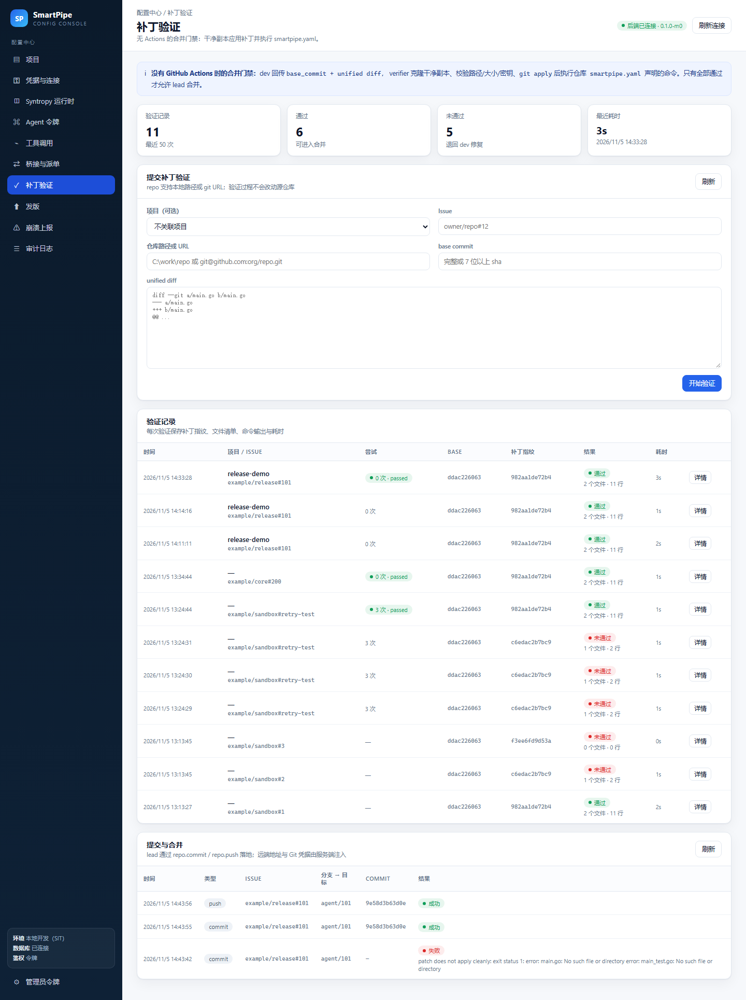

# M2 实施记录：补丁验证门禁（无 GitHub Actions）

更新时间：2026-11-05

## 1. 解决的问题

没有 GitHub Actions，合并前必须有一道可复现、可归档的验证：dev 交回补丁，lead 在干净副本上应用并执行仓库固定命令。
本轮实现了补丁协议校验、干净副本验证器、管理台入口与验证记录表。

```
dev:  base_commit + unified diff + 自测日志
        │  POST /admin/verifications（管理台）
        ▼
admin-api ──HTTP──▶ patch-verifier(:8095)
                      ├─ 结构化校验：base_commit、路径、大小、行数、二进制、密钥
                      ├─ git clone --no-hardlinks <repo> <tmp>/repo
                      ├─ git checkout --detach <base_commit>（校验 HEAD 前缀）
                      ├─ git apply --check → git apply
                      ├─ 读取 smartpipe.yaml，按 required_for_merge 顺序执行命令
                      └─ 返回 Report（文件清单、命令输出、耗时、补丁指纹）
        │
        └─ 写入 patch_verifications，审计 + 管理台「补丁验证」页
```

## 2. 补丁协议

```json
{
  "issue_id": "owner/repo#12",
  "repo": "C:\\work\\repo 或 git@github.com:org/repo.git",
  "base_commit": "ddac226063b9631e05dc752dc319e73a5f1683c5",
  "patch": "diff --git a/main.go b/main.go\n...",
  "test_log": "dev 本地自测输出（可选）",
  "environment": {"os": "windows", "go": "1.25.5"},
  "author": "dev-agent"
}
```

校验规则（`backend/internal/patch/bundle.go`）：

| 规则 | 行为 |
|---|---|
| `base_commit` 必填且为 7–40 位十六进制 | 否则拒绝 |
| 补丁 ≤ 1MB | 超过拒绝，要求拆分 |
| 变更行数 ≤ 500 | 超过拒绝 |
| 路径不得为绝对路径、不得含 `..` | 拒绝（`path traversal` / `absolute path`） |
| 禁止 `.github/workflows/`、`.git/`、`secrets/` | 拒绝（T-013） |
| 禁止二进制补丁 | 拒绝（`GIT binary patch` / `Binary files`） |
| 扫描新增行的私钥/Token（PEM、`ghp_`、`github_pat_`、AKIA、Slack、`sk-`） | 拒绝并标注类型（T-014） |
| 统一换行并补结尾换行 | 避免不同工作站产生不可应用补丁 |

补丁指纹：`sha256(规范化补丁)`，合并前用它复核「批准/验证的就是将要合并的内容」。

## 3. 验证契约 smartpipe.yaml

```yaml
version: 1
toolchain:
  go: "1.25"
commands:
  build: "go build ./..."
  unit: "go test ./..."
  integration: "go test -tags=integration ./..."
required_for_merge:
  - build
  - unit
timeouts:
  build: 2m
  unit: 3m
```

* `required_for_merge` 为空时按命令名排序全部执行。
* 未声明超时的命令默认 10 分钟；超时判失败并标记 `timed_out`。
* 契约缺失或 required 命令无定义 → 直接失败（`AllowMissingProfile` 只供本地调试）。
* 命令在干净克隆的工作目录执行，环境带 `CI=1`、`SMARTPIPE_VERIFY=1`、`GIT_TERMINAL_PROMPT=0`。

## 4. 验证器行为

`backend/internal/patch/verify.go`：

1. 结构化校验（失败时无需克隆，毫秒级返回）。
2. `os.MkdirTemp(WorkRoot)`，工作目录不存在会自动创建。
3. `git clone --no-hardlinks --quiet <repo> <tmp>/repo`，源仓库不会被修改。
4. `git checkout --detach <base_commit>`，再 `git rev-parse HEAD` 校验前缀一致（防 base 不符）。
5. 补丁写到临时文件（仓库外），先 `git apply --check` 再 `git apply`。
6. 读取 `smartpipe.yaml`，逐条执行；第一条失败即停止并保留已执行证据。
7. 返回报告：`ok`、`error`、`files`、`changed_lines`、`checks[]`、`duration_ms`、`patch_hash`、`head_commit`。
8. 默认删除临时目录；报告即归档证据。

命令行并发默认 2（`SMARTPIPE_VERIFY_CONCURRENCY`），单次总超时 30 分钟（`SMARTPIPE_VERIFY_TIMEOUT`）。

## 5. 接口

patch-verifier（:8095，`X-Verify-Token`）：

| 方法 | 路径 | 说明 |
|---|---|---|
| GET | `/healthz` | 健康检查 |
| POST | `/verify` | 请求体为第 2 节字段；通过 200，未通过 422，报告始终返回 |
| POST | `/commit` | 在 lead 的干净克隆上创建分支、应用补丁并提交，按需合并到目标分支；不执行 push |

管理台（:8092，Bearer）：

| 方法 | 路径 | 说明 |
|---|---|---|
| GET | `/admin/verifications?limit=` | 验证记录列表 |
| GET | `/admin/verifications/{id}` | 单条记录（含完整 report） |
| POST | `/admin/verifications` | 代理到 verifier，成功/失败都写入 `patch_verifications` 并审计 |

数据表 `patch_verifications`：项目、Issue、repo、base/head commit、补丁指纹、是否通过、文件清单、行数、
命令结果、错误、耗时、完整 report、创建时间。

环境变量：`SMARTPIPE_VERIFY_URL`、`SMARTPIPE_VERIFY_TOKEN`（admin-api 侧）；
`SMARTPIPE_VERIFY_ADDR`、`SMARTPIPE_VERIFY_TOKEN`、`SMARTPIPE_VERIFY_WORK_ROOT`、`SMARTPIPE_VERIFY_CONCURRENCY`、`SMARTPIPE_VERIFY_TIMEOUT`（verifier 侧）。

## 6. 提交与合并（/commit）

`CommitAndMerge` 只操作 lead 自己准备的干净克隆：

1. `git status --porcelain` 必须干净（仅 CRLF 换行差异时按索引刷新，其它改动/未跟踪文件拒绝）。
2. 校验 base_commit 存在，`git checkout -B agent/<issue> <base>`。
3. `git apply --check` → `git apply`，补丁规则与 /verify 相同。
4. `git add -A` + commit（默认作者 smartpipe-lead，可用 author_name/email 覆盖）。
5. 可选 `target_branch`：`checkout` 目标分支后 `git merge --no-ff`，返回目标分支 head。
6. 不执行 push：推送由 lead 用项目凭据单独完成，便于主分支保护与回滚。

实测（`.dev/sandbox-repo` 的干净克隆）：

```json
{"ok":true,"branch":"agent/issue-1",
 "commit":"253a03d7005b0e9fdbc5413c417c0a15cd19d9cc",
 "target_branch":"master",
 "target_head":"6dac82b48f6cba751db7523b83143051bdd0e03f",
 "message":"fix(#1): add Multiply"}
```

```
6dac82b Merge branch 'agent/issue-1'
253a03d fix(#1): add Multiply
ddac226 base
```

工作区在合并后保持干净；`main.go` 已包含 `Multiply`。

## 7. 端到端实测（2026-11-05）

沙箱仓库 `.dev/sandbox-repo`（Go，含 `smartpipe.yaml`），base commit `ddac226063b9631e05dc752dc319e73a5f1683c5`。

**通过用例**（新增 `Multiply` 与测试，id=1）：

```json
{"ok":true,"files":["main.go","main_test.go"],"changed_lines":11,
 "checks":[{"name":"build","ok":true,"exit_code":0,"duration_ms":321},
           {"name":"unit","ok":true,"exit_code":0,"duration_ms":1247,
            "output":"ok  \texample.com/sandbox\t0.018s\n"}],
 "duration_ms":2142,"patch_hash":"sha256:982aa1de72b4ea2a..."}
```

**逻辑错误用例**（把 Add 改成减法，id=2）：

```json
{"ok":false,"error":"verification command failed",
 "checks":[{"name":"build","ok":true},
           {"name":"unit","ok":false,"exit_code":1,
            "output":"--- FAIL: TestAdd (0.00s)\n    main_test.go:7: Add(1,2) != 3\nFAIL"}],
 "duration_ms":1030}
```

**越界路径用例**（`../evil`，id=3）：

```json
{"ok":false,"error":"patch: invalid: path traversal \"../evil\"","duration_ms":0}
```

管理台「补丁验证」页展示三条记录与详情（文件、命令输出、耗时），截图见 `docs/images/console-verify.png`。

## 8. 测试

```powershell
$env:GOPROXY='https://goproxy.cn,direct'
cd backend
go test ./internal/patch/ -count=1
```

覆盖：正常补丁解析、path traversal、工作流文件、绝对路径、密钥、二进制、超 500 行、base 不符、
补丁不干净、单测失败、Profile 解析/超时、WorkRoot 自动创建、干净副本 exec 全链路；
以及分支提交、`--no-ff` 合并、脏工作区拒绝、越界补丁拒绝。

`go test -p 1 ./...` 全量通过（adminapi、bridge、patch、store、runtime 等）。

## 9. 本地运行

```powershell
# 1. 构建
cd backend
go build -o bin\patch-verifier.exe .\cmd\patch-verifier

# 2. 启动（读取 .dev/env.json）
powershell -NoProfile -ExecutionPolicy Bypass -File scripts\dev-run-verifier.ps1

# 3. 提交验证
curl.exe -X POST -H "Authorization: Bearer dev-admin-token" -H "Content-Type: application/json" `
  --data-binary "@.dev\verify.json" http://127.0.0.1:8092/admin/verifications
```

## 10. 仍待完成（M2 之外）

1. **主分支保护落地**：`/push` 已禁止 force，但远端仓库的 branch protection 仍需在 GitHub 侧配置并由 lead 凭据执行。
2. **test 子 Agent 回归集**：独立集成/回归由 lead 派生 test Agent，验证服务已具备执行 integration 命令能力。
3. **真实仓库联调**：当前使用本地沙箱与裸仓库；接入真实 GitHub 仓库前需确认凭据与只读 clone 方式。
4. **M3/M4**：派生门禁（未批准禁止派生 dev）、发版流程与制品校验。


## 11. 工作区准备器（M2-1）

`internal/workspace.Manager` 按 Issue 准备持久工作区：

| 方法 | 路径 | 说明 |
|---|---|---|
| POST | `/workspaces` | `{id?, issue_ref?, repo, base_commit, branch?}`，默认 `id=ws-<hash(issue_ref)>`、`branch=agent/<id>` |
| GET | `/workspaces` | 列出工作区 |
| GET | `/workspaces/{id}` | 读取元数据 |
| DELETE | `/workspaces/{id}` | 回收（只允许删除 Root 下目录，含路径逃逸校验） |

* 工作区结构：`<root>/<id>/repo` + `workspace.json`；源仓库只读，不会改动。
* 同 ID 重复创建时校验 base 一致，不一致返回冲突。
* ID 只允许 `[A-Za-z0-9._-]`，拒绝 `../`、绝对路径与空值。
* `git -c core.autocrlf=false clone --no-hardlinks`，再 `checkout -B <branch> <base>`。

实测：`examples/sandbox#1` 创建工作区 `ws-5bbc04275d00`，分支 `agent/issue-1`，HEAD 与 base 一致，
文件齐全；`DELETE` 后目录与元数据都消失。

## 12. 推送分支（不 force）

`POST /push`（`X-Verify-Token`）：

```json
{"repo":"<干净克隆>","branch":"agent/issue-1","remote_url":"<裸仓库或远端 URL>"}
```

* 只推送指定分支，从不使用 `--force`。
* 推送前记录远端 ref（`git ls-remote`），推送后再次核对等于本地 commit。
* 远端拒绝非快进时返回 `ok=false` 与原始输出。

实测：把 `agent/issue-1`（commit `253a03d`）推到本地裸仓库，远端 ref 与本地一致；
另一个从同一 base 产生的 commit 再推同名分支被拒绝（non-fast-forward），符合主分支保护预期。

## 13. 失败回路（M2-7）

`issue_attempts` 记录每个 Issue 的验证失败次数：

* 验证失败：`attempts+1`，未到 3 次时 `state=retry_allowed`，达到 3 次置 `blocked`。
* 验证通过：`state=passed`，保留历史失败次数供回溯。
* 管理台接口：`GET /admin/attempts?issue_ref=...` 或列表；验证页展示「N 次 · 状态」。

实测：同一 Issue 连续 3 次提交失败补丁后 `attempts=3, state=blocked`；再提交通过补丁后变为 `state=passed`。

## 14. Linux Docker SIT

在 `192.168.1.99` 上用 `golang:1.25` 容器跑补丁与工作区测试（镜像内安装 git 2.47）：

```bash
sudo docker run --rm -v /tmp/m2sit:/src -w /src \
  -e GOPROXY=https://goproxy.cn,direct golang:1.25 \
  bash -c 'git --version && go version && go mod tidy && \
           go test ./internal/patch/ ./internal/workspace/ -count=1'
```

结果：

```
git version 2.47.3
go version go1.25.14 linux/amd64
ok  	smartpipe/backend/internal/patch	0.504s
ok  	smartpipe/backend/internal/workspace	0.062s
```

说明 Windows 本地使用的 git 2.54 与 Linux 容器内 git 2.47 在补丁应用、clone、分支/合并行为上一致。

## 15. lead 通过 MCP 落地提交与推送（2026-11-05）

补齐最后一公里：此前 `/commit`、`/push` 只有管理员 HTTP 接口，Agent 侧无法调用，lead 只能"干到验证"。
现在这两个动作也收敛进 `smartpipe-mcp`，lead 用同一个 `spt_` 令牌即可完成合并与推送。

| 工具 | 角色 | 背后接口 | 说明 |
|---|---|---|---|
| `repo.commit` | lead | `POST /admin/commits` → verifier `/commit` | 干净工作副本上应用补丁、建 `agent/<issue>` 分支并提交，可选合并到目标分支 |
| `repo.push` | lead | `POST /admin/pushes` → verifier `/push` | 推送分支并核对远端 ref，拒绝非快进（不 force） |

三条约束写进了实现：

1. **门禁前置**：`/admin/commits` 在落盘前再查一次 `gate.Check`，复杂 Issue 未 `/approve vN` 直接 403 `approval_required`。
2. **凭据不出进程**：`repo.push` 的 `remote_url` 由 admin-api 用项目 `github_repo_url` + 凭据库（`github_pat` / `github_app` 换安装令牌）拼出来，
   Agent 传什么都忽略；响应体里也不含 token。没有可用凭据时返回 503 `git_credential_unavailable`，不会退化成匿名推送。
3. **证据落库**：每次提交/推送写 `repo_ops`（迁移 v15），管理台「补丁验证」页新增「提交与合并」卡片；成功后自动在 Issue 下回写分支与 commit。

实测（`scripts/repo-merge-smoke.ps1`，真实 admin-api + 假 GitHub + 本地裸库）：

```
project=prj_7fd4ba83 remote=file:///.../.dev/remote.git
work=...\.dev\merge-work base=ddac226063b9631e05dc752dc319e73a5f1683c5
commit ok=True branch=agent/101 sha=9e58d3b63d0ea036b9efce26431bd48a5d41b012
push   ok=True branch=agent/101 after=9e58d3b63d0ea036b9efce26431bd48a5d41b012
REPO MERGE SMOKE OK project=prj_7fd4ba83 commit=9e58d3b63d0ea036b9efce26431bd48a5d41b012 remote_head=9e58d3b63d0ea036b9efce26431bd48a5d41b012
```

远端 `refs/heads/agent/101` 与提交 sha 一致；dev 令牌的 `tools/list` 里没有 `repo.commit` / `repo.push`。



单元测试 `internal/adminapi/mergeapi_test.go` 用假 verifier 覆盖：提交转发与 `repo_ops` 落库、
推送时注入 `x-access-token` 且响应不泄密、无凭据时 503 且不调用 verifier；`internal/mcp/roles_test.go` 锁定两个工具仅 lead 可见。
