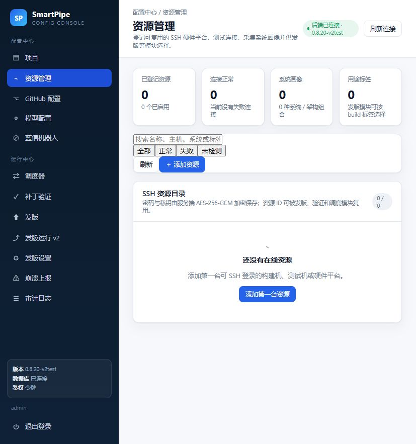

# SSH 资源管理实施记录

配置中心新增「资源管理」页面，用来登记发版、验证和调度模块可复用的远程硬件平台。当前支持通用 SSH 主机，资源 ID 作为其他模块的稳定引用。



## 已实现能力

- 添加与编辑资源：名称、用途说明、主机、端口、用户名、密码或 SSH 私钥、私钥口令、用途标签、启用状态。
- 删除资源，同时删除关联的加密凭据。
- 测试连接：服务端发起 SSH 认证并执行无害的远端命令，返回延迟、SSH Server 版本和主机指纹。
- 获取系统信息：只读采集主机名、操作系统、内核、架构、CPU、内存、根分区、运行时间、Docker/Git/Go/Node 等工具链，以及 `nvidia-smi` 可读取的 GPU。
- 资源目录：支持按连接状态、关键字和标签筛选；`build` 等标签供发版模块选择构建机。
- 安全存储：密码、私钥和私钥口令复用管理台的 AES-256-GCM 主密钥加密，API 与审计只返回掩码。
- 主机指纹：首次成功测连自动固定 SHA256 指纹，后续连接固定校验；更换主机时可在编辑页清除后重新固定。

## 数据表

复用 v1 已有的 `runtime_resources` 表，migration 43 `ssh_runtime_resources` 以 `ADD COLUMN IF NOT EXISTS` 幂等补齐 SSH 字段（`description/host/port/username/auth_type/secret_ciphertext/secret_mask/passphrase_ciphertext/host_key_fingerprint/tags/enabled/last_* /system_info/inspected_at`），并建立 `runtime_resources_enabled_idx`。

## API

| 方法 | 路径 | 用途 |
|---|---|---|
| GET | `/admin/resources` | 管理台资源列表 |
| POST | `/admin/resources` | 添加资源 |
| GET | `/admin/resources/available?tag=build` | 其他模块读取已启用且测连成功的资源 |
| GET | `/admin/resources/{id}` | 资源详情 |
| PATCH | `/admin/resources/{id}` | 编辑资源 |
| POST | `/admin/resources/{id}/enabled` | 启用或停用 |
| POST | `/admin/resources/{id}/test` | 测试 SSH 连接 |
| POST | `/admin/resources/{id}/inspect` | 采集系统信息 |
| DELETE | `/admin/resources/{id}` | 删除资源 |

## 其他模块接入方式

模块先通过 `GET /admin/resources/available?tag=build` 展示可选资源，保存资源 ID。后端执行时按 ID 取加密材料，并复用 `internal/resourceprobe`：

```go
resource, secret, passphrase, err := st.GetSSHResourceSecret(ctx, resourceID)
cfg := resourceprobe.Config{
    Host: resource.Host, Port: resource.Port, Username: resource.Username,
    AuthType: resource.AuthType, Secret: secret, Passphrase: passphrase,
    PinnedFingerprint: resource.HostKeyFingerprint,
}
output, fingerprint, err := resourceprobe.New().RunCommand(ctx, cfg, buildCommand, 30*time.Minute)
```

需要长连接、SFTP 或隧道时，可通过 `Prober.Connect` 取得底层 `*ssh.Client`（`SSHClient.RawClient()`）。发版模块应优先按标签筛选，再把具体资源 ID 写入发版记录，避免把 IP、密码或构建机配置复制到项目级配置。

## SSH 客户端

`internal/resourceprobe/sshclient.go` 提供本仓库内的最小 SSH 客户端，直接基于 `golang.org/x/crypto/ssh`：支持密码、私钥与私钥口令、键盘交互认证、主机指纹校验和命令超时。资源管理不再依赖旧仓库的 `common/mssh`，避免跨仓库模块耦合。

## 验证记录

- `go build ./...`、`go test ./internal/resourceprobe`、`npm run build` 通过。
- 部署到 192.168.1.99:28092 后，对 127.0.0.1:22 做过一次自检：添加资源 → 测试连接返回 `ok:true` 与 SHA256 指纹 → 采集系统信息拿到 CPU 型号、核数、磁盘与内核 → 删除返回 204。
- 项目下拉仍能列出 SmartPipe、Syntropy 两个项目。
