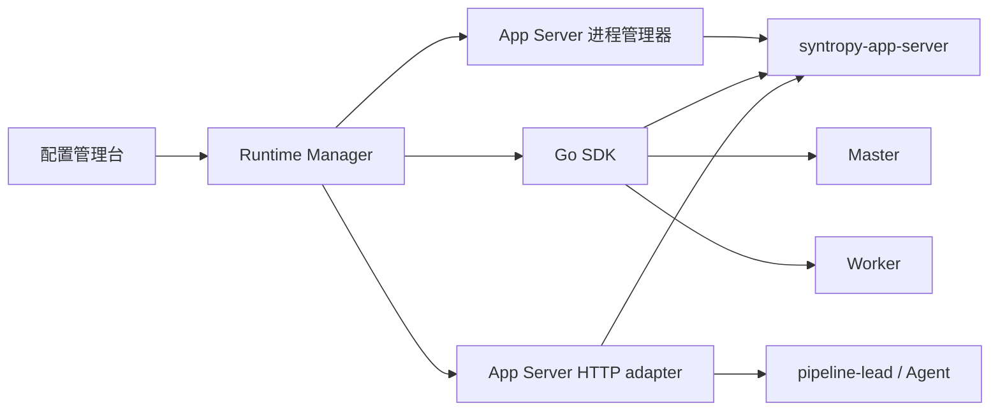

# Syntropy 运行时管理设计

日期：2026-11-05  
适用版本：主设计方案 v0.7.2  
源码参考：`D:\qax\reagent\dev\git\Syntropy`

## 1. 目标

在配置管理台中管理 SmartPipe 依赖的 Syntropy 运行时：

- 启动、停止和升级 App Server 进程。
- 通过 SDK 部署 Master、部署 Worker、查看部署进度和心跳。
- 创建 `pipeline-lead` Agent 实例，绑定项目、模板、节点和模型。
- 管理 Agent 模板，确保 `pipeline-lead` 等模板在 Master 中存在。
- 对 App Server、节点和 Agent 执行启动、停止、重启、暂停、回收等操作。
- 所有操作可审计、可幂等、失败可见。

## 2. 源码核对结论（重要）

根据当前 Syntropy 代码，能力边界如下：

| 能力 | 实际实现 | Runtime Manager 怎么做 |
|---|---|---|
| App Server 进程 | `web_backend/iris_app.go` 编译为 `syntropy-app-server`；桌面端由 `desktop_app/apps/desktop/src/main/cluster/sidecar-supervisor.ts` 启动 | Runtime Manager 管理进程和启动参数；SDK 连接启动后的 App Server |
| App Server 客户端 | `sdk/go/client.go`，`BaseURL` 指向 App Server，默认 `:8765` | 用 Go SDK 调任务、节点、Master 等接口 |
| Master 部署 | `sdk/go/master.go`：`Master.Deploy`、`DeployStatus`、`Registry`、`Activate` | 通过 SDK 部署并轮询进度 |
| Worker 部署 | `sdk/go/nodes.go`：`Nodes.Deploy`、`Ensure`、`Progress`、`List`、`Ping`、`Delete`、`Redeploy` | 通过 SDK 部署、选择和检查节点 |
| pipeline-lead Agent | App Server `/api/agents` 的 `DeployAgent`，请求体是 `AgentSpec`；见 `web_backend/service/agent/agent_service.go`、`api/proto/model/agent/agent.proto` | Go SDK 当前没有 Agents 分组，Runtime Manager 用 HTTP adapter 调 `/api/agents` |
| Agent 模板 | App Server `/api/agent-templates`；见 `web_backend/service/agent_template/agent_template_service.go` | 用 HTTP adapter 创建/同步模板；不能把模板文件直接散落在节点 |
| 任务和会话 | `sdk/go/tasks.go`、`sdk/go/sessions.go`；任务用 `MemberSpec.AgentTemplateID` 指定 Agent | 用 SDK 建任务、启动、订阅 SSE、发送消息 |
| 子 Agent | `CreateDerivedAgent` / `RemoveDerivedAgent` 走 Master AgentService；由 lead 自己调用 | Runtime Manager 不创建子 Agent |

### 2.1 App Server 不是 SDK 启动的

Go SDK 的 `Options.BaseURL` 默认是 `http://127.0.0.1:8765`，它假设 App Server 已经存在。当前 SDK README 也把“App Server 的 headless 常驻形态与 Bearer 服务令牌”列为缺口。

因此 Runtime Manager 需要两部分：

1. **进程管理器**：启动、停止、重启 `syntropy-app-server`，传入配置目录、节点制品目录、日志目录和临时 token。
2. **SDK/HTTP 客户端**：App Server 启动并通过健康检查后，再调用 Master/Node/Agent 接口。

App Server 启动参数可参考桌面 sidecar：

```text
--server-addr 127.0.0.1:<port>
--node-dir <artifacts>
--node-artifacts-dir <component artifacts>
--master-data-dir <component data>
--credential-dir <data dir>
--master-run-root <master run dir>
--master-registry-file <shared masters.json>
--log-dir <logs>
--desktop-token <ephemeral token>
--desktop-handshake
--desktop-watch-stdin
```

Runtime Manager 启动 App Server 后，应从 handshake 或健康检查取得实际地址，再创建 SDK Client。headless 常驻部署需要的服务 token 还没有正式平台能力，过渡期使用内网访问控制 + 临时 token。

### 2.2 pipeline-lead 是 Agent，不是“另一个 App Server”

`pipeline-lead` 对应一个 `AgentDeployment`：

```text
AgentSpec:
  project_id
  name
  target_node_id
  runtime = CODEX
  template_name = pipeline-lead-v3
  desired_state = RUNNING
  workspace
  resources
  labels
```

通过 `POST /api/agents` 的 `DeployAgent` 创建，返回 `AgentOperation`，再查询 `/api/agent-operations/{id}`。创建成功后：

- lead 作为该项目的通信和编排入口。
- lead 自己创建 dev/test/release 子 Agent（`CreateDerivedAgent`）。
- Runtime Manager 不创建子 Agent，也不代替 lead 处理蓝信/GitHub 消息。

如果只是为一个短任务运行临时 Agent，也可以走 SDK 的 `Tasks.Create` + `MemberSpec.AgentTemplateID`；这条路径与“常驻 pipeline-lead”是两种模式，UI 要明确区分。

## 3. Runtime Manager 的组成



Runtime Manager 负责：

- 进程管理：启动、停止、重启、健康检查、日志。
- SDK 适配：Master 部署、节点部署、节点列表、SSE。
- HTTP 适配：`/api/agents`、`/api/agent-templates`、`AgentOperation`。
- 操作编排：异步 operation、幂等、超时、审计和错误映射。
- 不创建子 Agent，不处理业务消息。

## 4. 管理页面

### 4.1 集群概览

- App Server 进程状态与 endpoint。
- Master 是否已部署、是否 active。
- Worker 在线数、心跳、资源、Agent 数。
- pipeline-lead 实例数和活跃任务。
- 最近操作与失败告警。
- 简化拓扑：App Server → Master → Worker → lead。

### 4.2 App Server

字段：

```text
name
endpoint
binary_version
data_dir
node_dir
log_dir
listen_addr
status
pid
last_health_at
```

操作：启动、停止、重启、查看日志、升级二进制。停止前检查是否有活跃任务。

### 4.3 节点

字段：

```text
node_name
role                 master | worker
addr
os / arch
deploy_mode          local | remote
cpu / memory / disk
labels
status               pending | online | draining | offline
agent_count
last_heartbeat
```

Master 操作：`Master.Deploy`、`DeployStatus`、`Registry`、`Activate`。  
Worker 操作：`Nodes.Deploy`、`Nodes.Ensure`、`Progress`、`Ping`、`Delete`。

### 4.4 pipeline-lead 实例

字段：

```text
agent_id
project_id
name
template_name
target_node_id
runtime
model
desired_state
phase
active_tasks
last_heartbeat
```

操作：Deploy、SetDesiredState（RUNNING/STOPPED）、Restart、Delete。创建后要等待 `AgentOperation` 完成，不能把“请求已提交”当成“Agent 已运行”。

### 4.5 Agent 模板

- 列出 Master 中的模板：`pipeline-lead-v3`、`dev-engineer-v3`、`test-runner-v3`、`release-manager-v3`。
- 从配置库导入/更新模板。
- 查看模板使用的 MCP、skills、plugins、模型和默认工具权限。
- 同步失败时禁止创建对应 Agent。

## 5. API 和操作模型

### 5.1 App Server 进程 API

```text
POST /admin/runtime/app-servers
POST /admin/runtime/app-servers/{id}/start
POST /admin/runtime/app-servers/{id}/stop
POST /admin/runtime/app-servers/{id}/restart
GET  /admin/runtime/app-servers/{id}/health
GET  /admin/runtime/app-servers/{id}/logs
```

### 5.2 Master / Worker

```text
GET  /admin/runtime/master/status
POST /admin/runtime/master/deploy
GET  /admin/runtime/master/deploy-status
POST /admin/runtime/master/activate

GET  /admin/runtime/nodes
POST /admin/runtime/nodes
GET  /admin/runtime/nodes/{id}/progress
POST /admin/runtime/nodes/{id}/ping
POST /admin/runtime/nodes/{id}/redeploy
DELETE /admin/runtime/nodes/{id}
```

### 5.3 Agent

```text
GET  /admin/runtime/agents
POST /admin/runtime/agents              # DeployAgent(AgentSpec)
GET  /admin/runtime/agents/{id}
POST /admin/runtime/agents/{id}/desired-state
POST /admin/runtime/agents/{id}/restart
DELETE /admin/runtime/agents/{id}
GET  /admin/runtime/agent-operations/{id}
```

### 5.4 操作记录

```text
operation_id
action
target_type
target_id
requested_by
started_at
finished_at
status               pending | running | succeeded | failed
error_code / message
```

长操作返回 `operation_id`，页面轮询或订阅；重复点击必须幂等。

## 6. 安全边界

- App Server token、SSH 密码、Master/Worker 凭据由配置/密钥服务保存，不进入浏览器页面源码。
- 启动 App Server 的进程参数中可能包含临时 token，日志必须脱敏。
- Master 部署和 Worker 加入属于高影响操作，需要管理员权限和二次确认。
- Worker 移除前先 drain；Master 有活跃 Agent/任务时禁止直接停止。
- pipeline-lead 的 `DeployAgent` 必须绑定已存在的模板；模板不存在时直接失败。
- 子 Agent 由 lead 自己创建，Runtime Manager 不提供“创建子 Agent”入口。
- 所有 SDK/HTTP 调用记录操作人、项目、目标、错误码和结果。

## 7. 验收用例

1. Runtime Manager 启动 `syntropy-app-server`，健康检查通过，SDK 能拿到 version。
2. 通过 SDK 部署 Master，`DeployStatus` 到达成功，`Registry` 显示 active。
3. 通过 SDK 部署 Worker，`Progress` 完成，`Ping` 成功。
4. 通过 `/api/agents` 部署 `pipeline-lead-v3`，`AgentOperation` 成功，Agent phase 为 RUNNING。
5. 模板不存在时创建 lead 被拒绝，页面显示明确错误。
6. 重复点击“创建”只产生一个 App Server 进程/Agent。
7. 停止有活跃任务的 Master 被拒绝；Worker 先 drain 再移除。
8. 非管理员不能调用运行时 API。
9. 页面不显示 App Server token、SSH 密码或 Agent secret 明文。
10. SDK 或 App Server 失败时页面显示失败状态和错误码，不显示“已成功”。

## 8. 实施顺序

1. 先写 App Server 进程管理器和健康检查，解决 SDK 的 `BaseURL` 前置条件。
2. 接 `Master.Deploy/DeployStatus/Registry/Activate`。
3. 接 `Nodes.Deploy/Ensure/Progress/List/Ping/Delete`。
4. 补齐 `/api/agents` 和 `/api/agent-templates` 的 HTTP adapter；当前 Go SDK 没有这两个公开分组。
5. 再接 pipeline-lead 的创建、启动、暂停、回收和模板同步。
6. 最后把 UI 的操作状态、审计和错误提示补齐。
