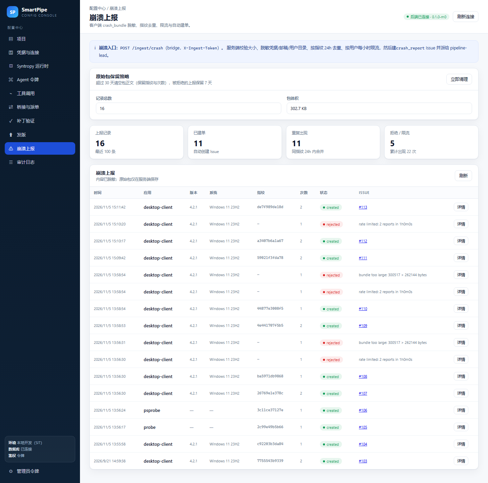
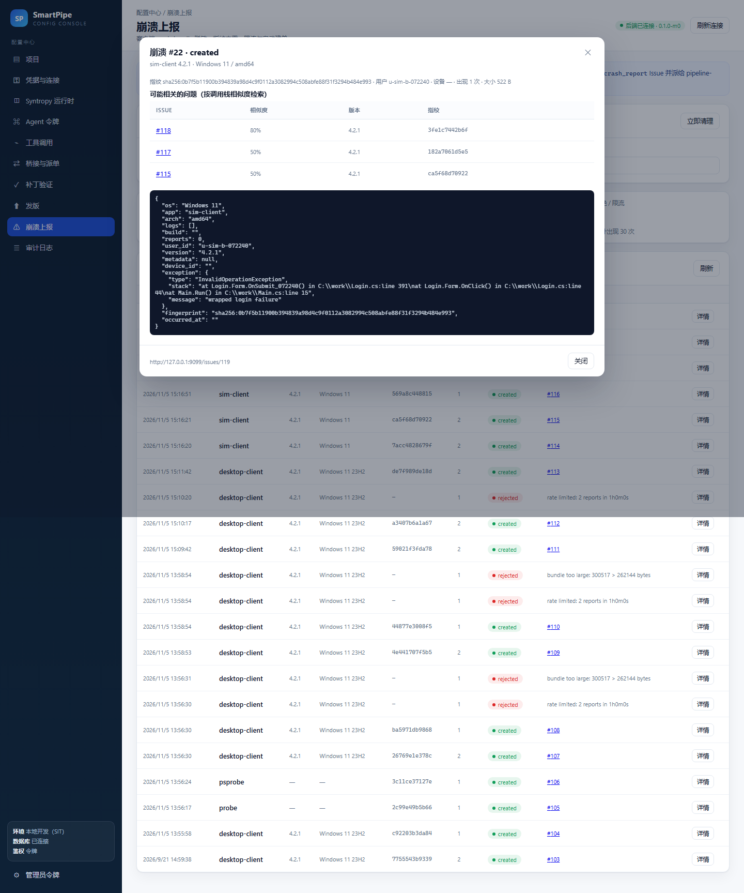
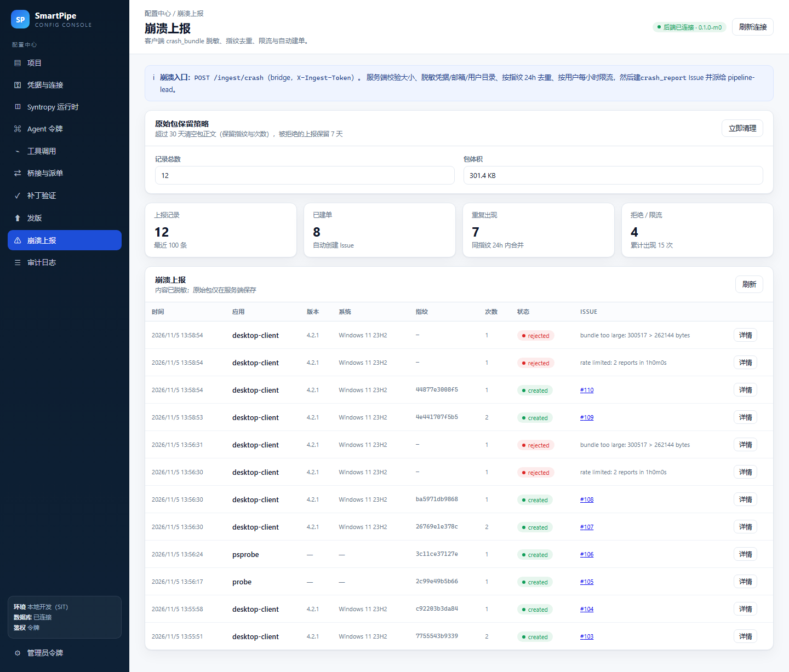

# 崩溃上报实施记录

更新时间：2026-11-05

## 1. 链路

```
客户端 crash_bundle
   │  POST /ingest/crash（X-Ingest-Token，bridge :8090）
   ▼
bridge  crash.Service.Ingest
   ├─ 大小校验（默认 256KB，HTTP 层 1MB 上限）
   ├─ 脱敏：GitHub/Slack/AWS/OpenAI token、bearer、password/token=、邮箱、用户目录
   ├─ 按用户限流（默认 5 次/小时）
   ├─ 指纹 = sha256(app + 异常类型 + 栈前 3 帧，忽略地址与行号)
   ├─ 24h 内同指纹合并：不新建 Issue，追加评论并累加 occurrences
   └─ 新建 GitHub Issue（标签 crash / crash_report / source:<渠道>），派单给 pipeline-lead
   ▼
crash_reports（记录、隔离后的 bundle、Issue 映射、出现次数）
```

## 2. 接口

`POST /ingest/crash`（bridge :8090，`X-Ingest-Token` 或 `SMARTPIPE_BRIDGE_TOKEN`）：

```json
{
  "project_id": "prj_xxx",
  "source": "lanxin",
  "bundle": {
    "app": "desktop-client",
    "version": "4.2.1",
    "build": "20261101.3",
    "os": "Windows 11 23H2",
    "arch": "amd64",
    "user_id": "u_123",
    "device_id": "d_abc",
    "occurred_at": "2026-11-05T10:00:00Z",
    "exception": {
      "type": "NullReferenceException",
      "message": "Object reference not set",
      "stack": "at Login.Form.Show() in Login.cs:line 42"
    },
    "logs": ["open login", "..."],
    "metadata": {"module": "login"},
    "fingerprint": ""
  }
}
```

| 响应 | 含义 |
|---|---|
| 201 `created` | 新建 Issue，返回 `issue_number`、`issue_url`、`report.id`、`fingerprint` |
| 200 `deduped` | 24h 内同指纹，返回原 Issue 与新的 `occurrences` |
| 429 `rate_limited` | 同一用户超过窗口内上限，未建单 |
| 422 `rejected` | 包过大或缺少必填字段，未建单 |

`project_id` 省略时使用 `SMARTPIPE_CRASH_PROJECT`。项目未配置 GitHub 仓库时返回 404/400。

管理台（Bearer 管理员令牌）：

| 方法 | 路径 | 说明 |
|---|---|---|
| GET | `/admin/crashes?limit=` | 上报列表（含脱敏 bundle） |
| GET | `/admin/crashes/{id}` | 单条详情 |

## 3. 脱敏规则

`internal/crash.Redact` 处理异常消息、栈、日志和元数据：

- `ghp_…`、`github_pat_…`、`AKIA…`、`sk-…`、`Bearer …` → `[REDACTED]`
- `password=…`、`token: …`、`secret=…`、`api_key=…`、`cookie=…` → `[REDACTED]`
- 邮箱 → `[email]`
- `C:\Users\<name>`、`/home/<name>`、`/Users/<name>` → `<home>`

限制：栈 ≤ 64KB、异常消息 ≤ 4KB、日志只保留最后 100 行（单行 ≤ 2KB），整体默认 ≤ 256KB 才建单。

## 4. 数据表

```sql
CREATE TABLE crash_reports (
    id BIGSERIAL PRIMARY KEY,
    project_id TEXT, fingerprint TEXT NOT NULL DEFAULT '',
    app TEXT, version TEXT, os TEXT, arch TEXT,
    user_id TEXT, device_id TEXT, source TEXT, repo TEXT,
    issue_number INTEGER DEFAULT 0, issue_url TEXT DEFAULT '',
    status TEXT DEFAULT '', reject_reason TEXT DEFAULT '',
    occurrences INTEGER DEFAULT 1, size_bytes INTEGER DEFAULT 0,
    bundle JSONB NOT NULL DEFAULT '{}'::jsonb,
    occurred_at TIMESTAMPTZ, created_at TIMESTAMPTZ, updated_at TIMESTAMPTZ
);
```

索引：`(project_id, fingerprint, created_at DESC)`、`(user_id, created_at DESC)`。

## 5. 端到端实测（2026-11-05）

```
powershell -NoProfile -ExecutionPolicy Bypass -File scripts\crash-smoke.ps1
CRASH SMOKE OK user=smoke-user-7541d295 issue=#107 report=5
  created=201 deduped=200 second=201 rate=429 oversize=422
  fingerprint=sha256:26769e1e378c8b33d6f82079e9bf9e4decc0610c2cef79b0fcb22dce61c32676
```

验证点：

1. 首次上报 → 201，Issue #107 创建，标签含 `crash_report`。
2. 相同指纹再次上报 → 200 deduped，`occurrences=2`，Issue 号不变，GitHub 上追加评论。
3. 不同指纹 → 201 新建第二个 Issue。
4. 同一用户第 3 次（limit=2）→ 429 rate_limited，不建单。
5. 300KB 日志 → 422 rejected，不建单。
6. Issue 与数据库中的 bundle 均不含 `ghp_…`、邮箱、`C:\Users\alice`，含 `[REDACTED]`。
7. 管理台 `/admin/crashes` 列表与详情可查。

管理台截图：`docs/images/console-crash.png`。

## 6. 环境变量

| 变量 | 说明 |
|---|---|
| `SMARTPIPE_CRASH_TOKEN` | 上报令牌；为空时回退 `SMARTPIPE_BRIDGE_TOKEN` |
| `SMARTPIPE_CRASH_PROJECT` | 默认项目（请求未带 `project_id` 时使用） |
| `SMARTPIPE_CRASH_MAX_BYTES` | 单包上限，默认 262144 |
| `SMARTPIPE_CRASH_RATE_LIMIT` | 每用户窗口内次数，默认 5 |

## 7. 蓝信一键上报（附件预检）

使用者不用懂 JSON：在群里 @ 机器人发一个 `crash_bundle.json` 文件（或图片转的 JSON），机器人下载附件、预检、转交桥接
`/ingest/crash`，然后把 Issue 链接回执到原消息下。

| 检查 | 行为 |
|---|---|
| 媒体类型 | 只接受文件（3）和图片（2），其它类型直接回提示 |
| 空文件 | 拒绝，提示重新发送 |
| 大小 | 超过 256KB（`CRASH_MAX_BYTES` 可调）直接回提示，**不调用上报接口** |
| JSON 结构 | 不是合法 `crash_bundle` 或缺 `app`/`exception.type` 时回提示 |
| 群聊 | 未 @ 机器人不处理，避免刷屏 |
| 上报结果 | `created` 回 Issue 链接；`deduped` 回第几次出现；`rate_limited` 提示稍后；`rejected` 带原因 |

命令：`/crash` 回一段字段说明。实现见 `backend/internal/bot/crash.go`，上报失败只回执不抛出（消息处理不会因此中断）。

本地联调加了两个测试钩子：

- `scripts/fake-lanxin.mjs`：假蓝信开放平台（appToken、`/v1/medias/{id}/fetch`、发消息、`/__messages` 回看）。
- `bot` 的 `POST /internal/events`（需 `X-Internal-Token`）：注入一条蓝信事件，走与线上完全相同的解析/幂等/上报路径。

实测（`scripts/bot-crash-smoke.ps1`，真实 bridge + Postgres + 假 GitHub）：

```
STEP 1 created -> 已建单：http://127.0.0.1:9099/issues/113（Issue #113），lead 会跟进。
STEP 2 oversized rejected -> 附件 300049 字节，超过上限 262144 字节（256 KB）。请只保留异常与调用栈，去掉日志和截图。
STEP 3 deduped -> 这个崩溃已在 24 小时内上报过，已合并为第 2 次出现（Issue #113）。
STEP 4 /crash help ok
BOT CRASH SMOKE OK replies=4
```

假蓝信的 `__messages` 里能看到三次回执都带 `refMsgId` 引用原消息，群 ID 为 `grp-release`。



单元测试 `internal/bot/crash_test.go` 覆盖：超限不上报、非法 JSON/缺字段、正常上报的 payload 与回执文案、
群里未 @ 不处理、`/crash` 帮助。

## 8. 测试

```powershell
cd backend
$env:SMARTPIPE_TEST_DSN='postgres://.../smartpipe_test?sslmode=disable'
go test ./internal/crash/ -count=1
```

覆盖：脱敏（token/邮箱/路径）、指纹对地址与行号不敏感、必填校验、日志截断、标题与正文、建单后正文引用 report id、同指纹去重累加、限流、超限拒绝。

## 9. 相似问题检索

指纹只能合并"完全相同"的崩溃；包装异常、改了行号、换了异常类型时会各建一单，分诊时看不到关联。
建单前现在会检索同应用最近 90 天已建单的崩溃，按调用栈相似度给出最多 3 条历史 Issue，写进正文：

```
## 可能相关的问题

- [#116](http://127.0.0.1:9099/issues/116) · 相似度 80% · 版本 4.2.1 · 指纹 `569a8c448815`
- [#115](http://127.0.0.1:9099/issues/115) · 相似度 50% · 版本 4.2.1 · 指纹 `ca5f68d70922`

> 仅按调用栈相似度自动检索，供分诊参考；合并前请人工确认根因。
```

算法：把栈前 6 行去掉地址与行号后做 Jaccard 相似度；异常类型不同时只作为参考（分数乘 0.8，且要求至少共享 2 帧），
低于 0.5 不提示。检索失败不影响建单（错误只记日志）。

实测（真实 bridge + Postgres + 假 GitHub，`/ingest/crash` 两次上报）：

```
first:  created issue=116
second: created issue=117
similar: [{"issue_number":116,"score":0.8,...},{"issue_number":115,"score":0.5,...}]
```

响应里的 `data.similar` 同时返回给调用方，便于后续在管理台展示。测试：`internal/crash/similar_test.go`
覆盖行号不敏感、类型不同打折、无关栈为 0、正文渲染与端到端写入；`internal/store/crash_similar_test.go` 覆盖落库与回填。

结果落库并展示：`crash_reports.similar_issues`（迁移 v17，JSONB，默认 `[]`）保存 top3，
`GET /admin/crashes/{id}` 原样返回，管理台崩溃详情弹窗新增「可能相关的问题」表格（Issue 链接、相似度、版本、指纹）。



顺带修了一个测试期暴露的问题：多个进程/测试包同时 `Migrate()` 会撞 `schema_migrations` 主键，
现在用 `pg_advisory_lock` 串行化迁移。

## 10. 原始包保留策略

崩溃包只用于定位，长期堆积会撑大库。这里给了一条可运营的保留线：

| 对象 | 默认 | 动作 |
|---|---|---|
| 已建单上报的原始包 | 30 天 | 正文置为 `{}`，保留指纹、次数、Issue 关联（证据不丢） |
| 被拒绝 / 限流的上报 | 7 天 | 整行删除（本来就没有 Issue） |

- 环境变量：`SMARTPIPE_CRASH_RETENTION_DAYS`（默认 30）、`SMARTPIPE_CRASH_REJECT_RETENTION_DAYS`（默认 7）、
  `SMARTPIPE_CRASH_RETENTION_HOURS`（默认 6 小时跑一次）、`SMARTPIPE_CRASH_RETENTION_SCHEDULE=off` 可关掉后台任务。
- 接口：`GET /admin/crashes/retention`（条数与包体积）、`POST /admin/crashes/retention/run`（立即执行并写审计 `crash.retention`）。
- 界面：崩溃上报页顶部「原始包保留策略」卡片，可看体积、点「立即清理」。

实测（真实 Postgres，把 1 条记录回拨 45 天）：

```
UPDATE crash_reports SET created_at = now() - interval '45 days' ... RETURNING id, length(bundle::text)
 id | len
  1 | 642

POST /admin/crashes/retention/run
{"bundles_cleared":1,"rejected_deleted":0,"bundle_days":30,"rejected_days":7}

GET /admin/crashes/retention
{"rows":12,"bundle_bytes":307951,...}   # 行数不变，体积从 308591 降到 307951
```

测试：`internal/store/retention_test.go` 覆盖超期包被清空但指纹/次数保留、拒绝记录被删除、未超期包不受影响。



## 11. 仍待完成

1. 与真实 GitHub 仓库联调（当前用假 GitHub 验证协议）。

## 12. 按蓝信群反查项目

崩溃上报请求支持 `chat_id`。`project_id` 为空或已失效（比如配置里留下旧项目）时，
bridge 会按项目的 `bluex_group_ids` 反查真实项目，期间不再整条 404。
机器人通知本身不再需要硬编码项目 ID：`scripts/dev-run-bot.ps1` 已去掉 `CRASH_PROJECT_ID`，
项目映射由配置台统一维护。
