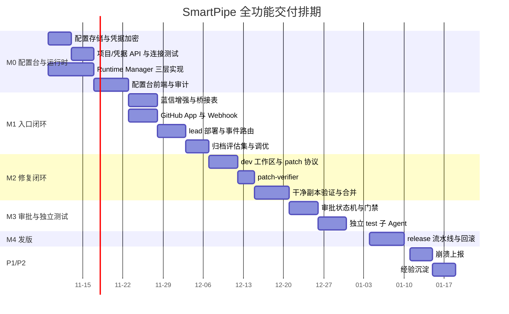

# 开发计划与测试环境方案

日期：2026-11-05  
基线：主设计方案 v0.7.2（GitHub Issue 驱动、单 lead、无 GitHub Actions）  
适用范围：从当前 M1 原型到"全功能可用"的完整开发、测试与环境准备

本文回答三件事：全部功能怎么拆成可执行的任务、每块功能怎么验证、需要什么开发与测试环境。字段级设计和接口规范仍以主方案与各专题文档为准，本文只做执行编排。

---

## 1. 交付范围

全功能拆成 15 个功能块，按里程碑归口：

| 编号 | 功能块 | 里程碑 | 一句话验收 |
|---|---|---|---|
| F1 | 蓝信入口（验签、去重、@过滤、附件、会话重置） | M1 | 同一消息重复投递只产生一个工作项 |
| F2 | GitHub Issue 桥接（创建、评论、标签、映射表） | M1 | 每条反馈可在 GitHub 找到 Issue 并反查来源 |
| F3 | 单 lead 团队（每 Issue 一个 pipeline-lead） | M1 | Issue 创建后 lead 在 5 分钟内接单并回复 |
| F4 | lead 自主派生 dev / test / release | M1/M2 | 桥接代码全程不调用 Agent 创建接口 |
| F5 | 复杂 Issue 方案讨论与审批门禁 | M3 | 未 `/approve vN` 时无法派生 dev |
| F6 | dev 工作区开发与自测 | M2 | dev 回传可复现的 patch + 自测日志 |
| F7 | 补丁校验（base_commit、路径、大小、密钥扫描） | M2 | 越界 patch 与含密钥 patch 一律拒绝 |
| F8 | lead 干净副本最终验证 | M2 | 只有干净副本命令全通过才允许合并 |
| F9 | 分支/PR/提交/合并（无 Actions） | M2 | 主分支只接受 lead 的合并 |
| F10 | 每日发版与回滚 | M4 | 连续 5 个工作日发版成功，回滚演练通过 |
| F11 | 集中配置管理台（项目、凭据、连接、审计） | M0 | Agent 全程拿不到 token 明文 |
| F12 | Syntropy 运行时管理（进程、节点、lead、模板） | M0 | 能在页面拉起 App Server 并部署一条 lead |
| F13 | 崩溃上报入口与自动建单 | P1 | 10 类模拟崩溃定级准确率 ≥ 80% |
| F14 | 相似 Issue 检索与经验沉淀 | P2 | 归并命中率可量化 |
| F15 | 审计与可观测（trace_id 贯穿、运行日志） | 全程 | 任一修复可回放到具体命令与证据 |

---

## 2. 现状盘点与处置

| 现有资产 | 当前状态 | 处置 |
|---|---|---|
| `backend/cmd/bot` | 蓝信 WS 长连接、幂等、@过滤、`/new`、`/healthz` 可用 | 保留增强：附件元数据、限流、死信、投递重试 |
| `sdks/lanxin` | 自研 Go SDK，含心跳重连 | 保留，补单测与 mock |
| `backend/cmd/orchestrator` | 规则 triage + 归档 + 回执 | 收敛为桥接/事件网关，规则 triage 只做兜底 |
| `backend/cmd/issue-service` | 内存版 Issue CRUD | 退出主路径，持久化能力降级为桥接表（Postgres） |
| `backend/cmd/patch-verifier` | 空 `main` | 按 F7 实现 |
| `backend/cmd/release-service` | 空 `main` | 按 F10 实现（或并入 lead 工具，二选一） |
| `backend/cmd/ci-adapter` / `mcp-gateway` | 空 `main` | 新方案下由 `smartpipe-mcp` 统一承担，若无用直接删 |
| `web/` | Vite 空壳 + 静态 `config-demo.html` | 配置台按 Demo 落地为 React 页面 |
| `deploy/docker-compose.yml` | 只有 Postgres/Redis 骨架 | 补 bridge、web、mcp，并加 schema 迁移 |

---

## 3. 里程碑与排期

按 2 名工程师 + Agent 协作估算，共约 10 周、约 100 人日。



| 里程碑 | 周期 | 出口条件（不满足不进入下一阶段） |
|---|---|---|
| M0 | 第 1–2 周 | 页面能启动 App Server 进程、SDK 部署 Master/Worker、`/api/agents` 部署一条 lead；凭据不出服务端 |
| M1 | 第 3–4 周 | 20 条样例归档准确率 ≥ 90%；重复消息不重复建单；lead 5 分钟内响应 |
| M2 | 第 5–6 周 | 1 个真实 Bug 走完 Issue → dev → 验证 → 合并，且全程无 Actions |
| M3 | 第 7–8 周 | 未审批的复杂 Issue 无法派生 dev；`/approve v1` 后改 `v2` 自动失效 |
| M4 | 第 9 周 | 连续 5 个工作日发版成功，完成 1 次回滚演练 |
| P1/P2 | 第 10 周起 | 崩溃定级准确率 ≥ 80%；相似检索命中率可量化 |

---

## 4. 分阶段任务分解

估时为工程师人日，不含 Agent 自跑时间。

### 4.1 M0：集中配置管理台 + Syntropy 运行时

| ID | 任务 | 产出 | 依赖 | 估时 |
|---|---|---|---|---|
| M0-1 | 配置库与迁移 | Postgres schema：projects、credentials、project_bindings、audit_log、runtime_resources | 无 | 2 |
| M0-2 | 凭据加密服务 | AES-GCM 封装，主密钥从环境注入；write-only API，只回掩码 | M0-1 | 2 |
| M0-3 | 项目注册 API | `/admin/projects` CRUD、启停、工具权限集 | M0-1 | 2 |
| M0-4 | 连接测试 | GitHub 仓库读、蓝信 app token、Syntropy health、Git 浅克隆 | M0-2 | 3 |
| M0-5 | Runtime Manager 进程管理 | spawn `syntropy-app-server`、读 handshake、健康检查、日志落盘、优雅退出 | 无 | 3 |
| M0-6 | Go SDK 适配 | `Master.Deploy/DeployStatus/Registry/Activate`、`Nodes.Deploy/Ensure/Progress/Ping/Delete` | M0-5 | 3 |
| M0-7 | Agent HTTP adapter | `/api/agents`、`/api/agent-operations`、`/api/agent-templates` 封装与错误映射 | M0-5 | 3 |
| M0-8 | 配置台前端 | 项目、凭据、运行时、审计四页，对齐现有 Demo | M0-3、M0-7 | 5 |
| M0-9 | 审计 | 写操作全部落审计，含操作人、目标、结果、trace_id | M0-3 | 1 |
| M0-10 | 冒烟脚本 | 一条命令拉起环境并验证进程/节点/lead 三层 | M0-7 | 2 |

### 4.2 M1：蓝信到 GitHub Issue 闭环

| ID | 任务 | 产出 | 依赖 | 估时 |
|---|---|---|---|---|
| M1-1 | 桥接表 | `source_message_id`、`chat_id`、`lanxin_user_id`、`repo`、`issue_number`、`syntropy_task_id`，唯一约束 | M0-1 | 2 |
| M1-2 | 蓝信入站增强 | 附件元数据、图片转存、限流、重复消息归并、`/new` 重置 | 现有 bot | 3 |
| M1-3 | GitHub App 客户端 | issue 创建/评论/加标签/查重，installation token 缓存 | M0-4 | 3 |
| M1-4 | Webhook 接收 | 验签、重放防护、事件去重、Issue 评论事件路由给 lead | M1-3 | 3 |
| M1-5 | lead 部署与路由 | 每 Issue 一条 lead（`/api/agents`），任务消息带 `project_id` + `issue_url` | M0-7、M1-1 | 4 |
| M1-6 | lead 模板与工具清单 | `configs/agents/pipeline-lead/AGENTS.md` 落到模板，工具白名单校验 | M1-5 | 2 |
| M1-7 | 可靠性 | 失败重试、死信、告警；Webhook 与蓝信双通道幂等 | M1-4 | 2 |
| M1-8 | 归档评估 | 20 条样例 + 评分脚本，记录准确率 | M1-5 | 3 |

### 4.3 M2：dev 修复与 lead 最终合并

| ID | 任务 | 产出 | 依赖 | 估时 |
|---|---|---|---|---|
| M2-1 | 工作区准备器 | 按 Issue 建独立 clone/worktree，检出 `base_commit`，只读挂载 | M1-5 | 3 |
| M2-2 | patch 协议 | `base_commit + unified diff + 自测日志 + 环境指纹` 的回传格式与校验 | M2-1 | 2 |
| M2-3 | patch-verifier | 路径白名单、大小上限、二进制定位、密钥/凭证扫描、`git apply --check` | M2-2 | 3 |
| M2-4 | 验证契约解析 | `smartpipe.yaml`：build/lint/unit/integration 命令、超时、工具链版本 | 无 | 2 |
| M2-5 | 干净副本验证器 | 临时目录、干净 clone、逐条执行、超时与日志归档、证据 JSON | M2-4 | 4 |
| M2-6 | 提交与合并 | 分支 `agent/<issue>`、commit message 规范、PR、lead 合并、主分支保护校验 | M2-5 | 3 |
| M2-7 | 失败回路 | 失败回传 dev、最多 3 轮、超限置 `blocked` 并通知 | M2-6 | 2 |
| M2-8 | dev 模板 | `configs/agents/dev-engineer/AGENTS.md` + 派生命令 + 工具白名单 | M2-1 | 2 |

### 4.4 M3：复杂 Issue 讨论、审批与独立测试

| ID | 任务 | 产出 | 依赖 | 估时 |
|---|---|---|---|---|
| M3-1 | 状态机与标签 | `discussing / awaiting_approval / approved / in_progress / blocked / done` 与标签映射 | M1-4 | 2 |
| M3-2 | 方案版本化 | lead 发 `方案 vN` 评论，正文哈希入表；新版本自动作废旧批准 | M3-1 | 3 |
| M3-3 | 评论命令 | `/plan`、`/changes`、`/hold`、`/reject`、`/approve vN` 解析与回执 | M3-2 | 2 |
| M3-4 | 审批校验 | 评论人仓库权限 + CODEOWNERS + 版本号 + 内容哈希，三重校验 | M3-3 | 3 |
| M3-5 | 派生门禁 | 派生 dev 前强制检查 `approved`，未通过返回 `approval_required` | M3-4、M2-8 | 2 |
| M3-6 | test 子 Agent | 干净副本跑集成/回归，只回报告不改码 | M2-5 | 4 |
| M3-7 | 讨论同步 | 方案与结论摘要回写蓝信，标明"转述不构成批准" | M3-4 | 1 |

### 4.5 M4：每日发版与回滚

| ID | 任务 | 产出 | 依赖 | 估时 |
|---|---|---|---|---|
| M4-1 | 触发与候选集 | 06:00 Automation 触发，读取 `smartpipe:ready` 集合 | M2-6 | 2 |
| M4-2 | Release Note | 按 Issue 分类生成变更说明，附验证证据链接 | M4-1 | 2 |
| M4-3 | 构建与制品 | 按契约构建、产物目录、校验和、可选签名 | M2-4 | 3 |
| M4-4 | 发布 | tag + GitHub Release + 制品上传，成功后回写 `smartpipe:released` | M4-3 | 2 |
| M4-5 | 回滚 | 保留上一版本，脚本化回滚并通知 | M4-4 | 2 |
| M4-6 | 通知 | 蓝信播报版本号、Issue 列表、升级提示 | M4-4 | 1 |

### 4.6 P1/P2

| ID | 任务 | 产出 | 估时 |
|---|---|---|---|
| P1-1 | 崩溃上报入口 | crash_bundle 上传、脱敏、限流、自动建 `crash_report` Issue | 4 |
| P1-2 | 定级评估 | 10 类模拟崩溃，人工标注对比准确率 | 2 |
| P2-1 | 相似检索 | 向量或关键词检索历史 Issue 与修复，归并建议 | 4 |
| P2-2 | 身份映射 | 蓝信用户 ↔ GitHub 账号映射与展示 | 2 |

---

## 5. 测试方案

### 5.1 分层与工具

| 层级 | 覆盖什么 | 工具 | 运行位置 | 频率 |
|---|---|---|---|---|
| 单元 | 解析、校验、状态机、命令解析、哈希 | `go test ./...`，表驱动 | 开发机 | 每次提交 |
| 契约 | 外部依赖的请求/响应形状 | `httptest` 假 GitHub/蓝信/App Server + golden JSON | 开发机 | 每次提交 |
| 集成 | 与 Postgres、App Server、Master/Worker 的真实交互 | docker compose + 本地 app server | SIT | 每日 |
| 端到端 | 完整链路 | 脚本驱动 + sandbox 仓库 + 测试蓝信群 | STAGING | 每日/发版前 |
| 回归 | 历史 Bug 重放 | 5 个历史 Issue 的 replay 脚本 | STAGING | 每周 |
| 安全 | 权限、凭据、审批伪造 | 权限矩阵用例 + 密钥扫描 | SIT/STAGING | 每周 |
| 韧性 | 依赖故障 | 故障注入（kill、断网、慢响应、重放） | SIT | 每阶段末 |
| 容量 | 并发与吞吐 | 并发 5/20 Issue、Webhook 50 rps | SIT | M2 后 |

没有 GitHub Actions，所以"CI"由三件事替代：开发机本地 `go test`、SIT 上的每日定时集成跑、lead 的干净副本验证。三者都必须留证据文件。

### 5.2 功能 × 环境矩阵

| 功能 | 单元 | 契约 | 集成 | 端到端 |
|---|---|---|---|---|
| F1 蓝信入口 | 去重/解析 | 蓝信 API mock | 测试机器人连通 | 真群投递 |
| F2 Issue 桥接 | 命令拼装 | GitHub API mock | 真仓库（sandbox） | 全链路 |
| F3/F4 lead 团队 | 路由决策 | Agent API mock | 真 App Server 部署 lead | 全链路 |
| F5 审批门禁 | 状态机/哈希 | 评论事件 mock | 真 Issue 评论 | 全链路 |
| F6/F7 开发与校验 | 校验规则 | patch 样本 | 真仓库应用 | 全链路 |
| F8/F9 验证与合并 | 契约解析 | 命令执行器 | 干净副本 | 全链路 |
| F10 发版 | Note 生成 | GitHub Release mock | 真 Release（sandbox） | 全链路 |
| F11/F12 配置与运行时 | 加密/掩码 | 管理 API | 真 Postgres + App Server | 页面操作 |

### 5.3 核心测试用例

| ID | 场景 | 期望 | 环境 |
|---|---|---|---|
| T-001 | 同一 `platform_message_id` 投递 3 次 | 只建 1 个 Issue，3 次都回同一链接 | SIT |
| T-002 | 未 @ 机器人且 `BOT_REQUIRE_AT_ME=true` | 不建单 | 单元 |
| T-003 | 20 条样例归档 | 准确率 ≥ 90%，误建单为 0 | STAGING |
| T-004 | Webhook 重放同一 `delivery` | 幂等，不重复触发 lead | SIT |
| T-005 | Webhook 签名错误 | 401，审计留痕 | 单元 |
| T-006 | Issue 创建后 5 分钟 | lead 已回复并打上状态标签 | STAGING |
| T-007 | 同一 Issue 重复派活 | 复用同一 lead，不新建团队 | SIT |
| T-008 | lead 创建 dev 子 Agent | 桥接日志中无 Agent 创建调用 | STAGING |
| T-009 | 复杂 Issue 直接触发开发 | 拒绝，返回 `approval_required` | SIT |
| T-010 | `/approve v1` 后改 `v2` | v1 批准失效，需 `/approve v2` | SIT |
| T-011 | 无权限用户 `/approve v1` | 拒绝并审计 | SIT |
| T-012 | 方案正文改一个字但版本号不变 | 哈希不匹配，门禁拒绝 | 单元 |
| T-013 | patch 修改 `.github/workflows/*` | 拒绝（路径白名单） | 单元 |
| T-014 | patch 含私钥/Token 字样 | 拒绝并告警 | 单元 |
| T-015 | patch 超过 1MB 或 500 行 | 拒绝并要求拆分 | 单元 |
| T-016 | `base_commit` 与仓库当前不一致 | `git apply --check` 失败，退回 dev | SIT |
| T-017 | dev 自测通过但干净副本失败 | 阻止合并，退回 dev 并附失败日志 | STAGING |
| T-018 | 连续 3 轮修复失败 | Issue 置 `blocked` 并通知维护者 | STAGING |
| T-019 | 干净副本中 `smartpipe.yaml` 命令超时 | 判失败，记录超时与部分日志 | SIT |
| T-020 | dev 尝试 `git push` | 权限拒绝 | STAGING |
| T-021 | 合并后主分支被 force push | 仓库保护拒绝 | STAGING |
| T-022 | 发版构建失败 | 不发 Release，保留日志并告警 | SIT |
| T-023 | 发版成功 | tag、Release、Note、`smartpipe:released` 齐全 | STAGING |
| T-024 | 回滚演练 | 30 分钟内恢复上一版本并通知 | STAGING |
| T-025 | 凭据轮换 | 旧值立即失效，新任务用新值 | SIT |
| T-026 | 通过 API 读取凭据 | 只返回 `****last4` | 单元 |
| T-027 | 日志与错误响应扫描 | 无 token 明文（正则白名单扫描） | SIT |
| T-028 | 非管理员调用 `/admin/*` | 403 | 单元 |
| T-029 | 重复点击"创建 App Server" | 只产生 1 个进程 | SIT |
| T-030 | kill App Server 进程 | 页面显示离线，SDK 调用返回明确错误，不自称成功 | SIT |
| T-031 | Worker 掉线 | 任务不派到该节点，页面标记 offline | SIT |
| T-032 | Master 有活跃任务时删除 | 拒绝 | SIT |
| T-033 | 部署 lead 但模板不存在 | 直接失败并提示同步模板 | SIT |
| T-034 | AgentOperation 长期 pending | 超时失败，可重试，不显示运行中 | SIT |
| T-035 | 并发 20 个 Issue | 无跨 Issue 串台，lead 与工作区正确隔离 | SIT |
| T-036 | 同一项目两个 Issue 同时改同一文件 | 第二个合并冲突，退回 dev | STAGING |
| T-037 | 蓝信附件超限/类型非法 | 拒绝并回执说明 | 单元 |
| T-038 | 崩溃上报重复 | 归并到同一 `crash_report` Issue | SIT |
| T-039 | 10 类模拟崩溃定级 | 准确率 ≥ 80% | STAGING |
| T-040 | 全链路 trace 查询 | 由 Issue 号可查到每次命令与证据 | STAGING |

### 5.4 测试数据与 fixture

- **sandbox 仓库**：一个刻意做小的 Go 服务（含 3 个已知 Bug、1 个复杂需求、1 个 flaky 测试），根目录 `smartpipe.yaml` 固定 build/lint/unit 命令。
- **蓝信样例集**：20 条消息，覆盖正常 Bug、重复、@、图片、附件、崩溃、无效提问、多项目混淆。
- **patch 样本集**：正常、越界路径、超大、含密钥、base 不符、二进制、改测试断言放水，共 8 个。
- **审批样本集**：合法批准、无权限批准、版本过期、正文被改、CODEOWNERS 不满足，共 6 条。
- **历史 Bug 重放**：从真实仓库挑 5 个已修复 Issue，作为回归基准。

---

## 6. 环境需求

### 6.1 环境划分

| 环境 | 用途 | 数据 | 谁能改 |
|---|---|---|---|
| DEV | 单机开发、单元与契约测试 | mock/fixture | 工程师 |
| SIT | 联调：真 Postgres、真 App Server、sandbox 仓库 | 沙箱数据，可清空 | 工程师 |
| STAGING | 与生产同构的验收：真蓝信测试群、真 GitHub sandbox、真发版链路 | 沙箱数据 | 发布负责人 |
| PROD | 正式项目接入 | 真实业务 | 运维 + 管理员 |

### 6.2 硬件与系统

| 角色 | 规格 | 系统 | 数量 | 说明 |
|---|---|---|---|---|
| 开发机 | 8C / 32G / 200G SSD | Windows 11 + WSL2（或直接 Ubuntu） | 每人 1 台 | 需能跑 Docker、Go、Node、Chrome |
| App Server 主机 | 4C / 8G / 100G | Ubuntu 24.04 | 1 | 常驻，暴露 8765；与 Master 同机也可 |
| Master 节点 | 8C / 16G / 200G | Ubuntu 24.04 | 1 | 控制面 + 任务调度 |
| dev Worker | 16C / 32G / 500G SSD | Ubuntu 24.04 | 1–2 | 拉仓库、构建、跑单测 |
| test Worker | 8C / 16G / 200G | Ubuntu 24.04 | 1 | 干净副本集成验证 |
| 数据库主机 | 4C / 8G / 200G | Ubuntu 24.04 | 1 | Postgres 16，可复用 Master 主机 |
| 网关/反向代理 | 2C / 4G | Ubuntu 24.04 | 1 | 承接 GitHub Webhook 入站与 TLS |

如果初期只有一台机器，可先用「一台 16C/64G 的 Linux + Docker Compose」把 SIT 全部塞进去，再拆成上表。

### 6.3 软件与版本

| 软件 | 版本 | 用途 |
|---|---|---|
| Go | 1.24+（backend 模块） | 桥接服务、Runtime Manager |
| Go | 1.26.5（Syntropy `go.mod` 要求） | 从源码构建 `syntropy-app-server`；版本不够时用官方预编译二进制 |
| Node.js | 20 LTS | 配置台前端、E2E 脚本 |
| pnpm / npm | 随 Node | 前端依赖 |
| PostgreSQL | 16 | 配置库、桥接表、审计 |
| Redis | 7（可选） | 幂等键、限流计数；MVP 可先用 Postgres |
| Docker / Compose | 27+ | 本地与 SIT 环境编排 |
| Git | 2.40+ | worktree、`git apply`、合并 |
| PowerShell 7 / Git Bash | 最新 | Windows 开发机脚本 |
| Chrome / Playwright | 稳定版 | 页面截图与 E2E |
| 蓝信客户端 | 最新 | 手工验收测试群消息 |

### 6.4 网络与端口

| 服务 | 端口 | 方向 | 说明 |
|---|---|---|---|
| `syntropy-app-server` | 8765（默认） | 内网入站 | SDK `BaseURL` 默认值 |
| bot HTTP | 8091 | 内网 | `/healthz` |
| 桥接/orchestrator | 8090 | 内网 | bot 与 MCP 调用 |
| 配置台后端 | 8092 | 内网 + 管理员网段 | `/admin/*` |
| 配置台前端 | 8080 | 管理员网段 | 静态站点 |
| PostgreSQL | 5432 | 内网 | 仅内网 |
| Redis | 6379 | 内网 | 可选 |

出站要求：`github.com`、`api.github.com`（443）、蓝信 API 网关（443）、Go module proxy、npm registry。

入站要求：**GitHub Webhook 必须能从公网到达**。内网部署时用反向代理 + 独立子域名，只放行 `/webhooks/github` 路径并校验签名。完全无公网的场景需要降级为定时轮询 Issue 事件（延迟 1–5 分钟），这一点要在 M1 设计时确认。

### 6.5 账号与凭据清单

| 凭据 | 用途 | 由谁提供 | 存放位置 | 轮换 |
|---|---|---|---|---|
| GitHub App ID / Private Key | 签发 installation token | 仓库管理员 | 配置台密文库 | 90 天 |
| GitHub App installation ID | 绑定仓库 | 安装时生成 | 配置库（非密） | 重装时更新 |
| GitHub Webhook secret | 校验入站事件 | 随机生成 | 配置台密文库 | 90 天 |
| 蓝信 App ID / App Secret / API Base | 收发消息 | 蓝信管理员 | 配置台密文库 | 180 天 |
| Syntropy 服务 token | 调 App Server | 平台方 | 配置台密文库 | 按平台策略 |
| Git SSH / PAT（只读） | 干净副本 clone | 仓库管理员 | 配置台密文库 | 90 天 |
| 发版签名密钥 | 制品签名（如需） | 安全团队 | KMS/密文库 | 按策略 |
| 主加密密钥 | 加密上述凭据 | 运维 | 主机环境变量 / KMS | 年度 |

访问 Syntropy App Server 的 token 目前只有桌面 sidecar 的临时 token，headless 常驻形态与正式服务令牌仍是平台缺口。SIT/STAGING 阶段先用内网访问控制 + 短期 token，生产接入前必须由平台补齐。

### 6.6 环境搭建步骤（SIT 参考）

```bash
# 1. 基础依赖
docker compose -f deploy/docker-compose.yml up -d postgres

# 2. 建库与迁移
psql "$SMARTPIPE_DSN" -f deploy/postgres/schema.sql

# 3. 构建并启动 App Server
go build -o bin/syntropy-app-server ./web_backend            # 在 Syntropy 仓库
./bin/syntropy-app-server --server-addr 0.0.0.0:8765 \
  --node-dir /data/nodes --node-artifacts-dir /data/artifacts \
  --master-data-dir /data/master --credential-dir /data/cred \
  --master-run-root /data/master-run --log-dir /data/logs

# 4. 健康检查
curl -s http://127.0.0.1:8765/healthz

# 5. 部署 Master/Worker（Runtime Manager 或 SDK 脚本）
smartpipe-runtime deploy --role master --addr 10.12.8.20
smartpipe-runtime deploy --role worker --name worker-dev-01 --labels dev,go

# 6. 同步模板并部署 lead
smartpipe-runtime template sync configs/agents/pipeline-lead
smartpipe-runtime lead create --project core --template pipeline-lead-v3 --node worker-dev-01

# 7. 启动 SmartPipe 服务
go run ./cmd/bridge        # 桥接 + 配置台后端
pnpm --dir web dev         # 配置台前端

# 8. 冒烟
./scripts/smoke.sh         # 进程/节点/lead 三层 + 一次假 Issue 全链路
```

---

### 6.7 当前开发机盘点（2026-11-05 实测）

| 组件 | 实测结果 | 结论 |
|---|---|---|
| Go | go1.26.5 windows/amd64 | 满足 backend（1.24）与 Syntropy（1.26.5）两套要求 |
| Node | v24.15.0 | 满足前端与脚本需求 |
| Git | 2.54.0.windows.1 | 满足 worktree 与 `git apply` |
| Docker | 未安装 | 需安装 Docker Desktop + WSL2，用于 Postgres 与 SIT 编排 |
| psql | 未安装 | 可只用容器内 psql，或装客户端工具 |
| Chrome | 已安装 | 可用于页面截图与 E2E |

开发机还需补的只有容器环境；如果暂时不装 Docker，可以先用远程 SIT 的 Postgres 直连开发，把 Docker 留到联调阶段。

## 7. 质量门禁（DoD）

每个里程碑结束时必须同时满足：

1. 新增代码单元测试覆盖关键分支，`go test ./...` 全绿。
2. 对应功能的契约测试用 mock 覆盖，外部依赖不可用时可跑。
3. SIT 上至少跑通一次该功能的集成路径，证据文件归档。
4. 涉及权限的改动通过权限矩阵测试（dev 无外发、无 push）。
5. 日志扫描无 token 明文。
6. 文档同步：主方案、本文、对应专题文档的字段与接口一致。

---

## 8. 风险与应对

| 风险 | 影响 | 应对 |
|---|---|---|
| App Server 无正式服务令牌 | 常驻部署依赖临时 token | 内网 + 访问控制过渡；同步推动平台补齐 |
| GitHub Webhook 不可公网可达 | 无法实时接收事件 | 反向代理子域名；或降级为轮询 |
| Go 1.26.5 工具链不可得 | 无法从源码构建 App Server | 使用官方预编译二进制；版本锁在环境文档 |
| lead 派生能力未验证 | F4 阻塞 | M1 第一周先做能力探测，失败则降级为固定角色 + A2A |
| 真实仓库测试污染 | 误合并 | 全程在 sandbox 仓库验证，生产仓库只读到 M2 后期 |
| Agent 测试不稳定 | 端到端结果抖动 | 关键判定落服务端校验，不依赖模型自述 |
| 修复质量不足 | 合并回退 | 干净副本门禁 + 历史 Bug 回归集 |

---

## 9. 工时汇总

| 阶段 | 人日 | 说明 |
|---|---|---|
| M0 | 26 | 配置台 + 运行时管理 |
| M1 | 22 | 入口与 Issue 闭环 |
| M2 | 21 | 修复与合并 |
| M3 | 17 | 审批与独立测试 |
| M4 | 12 | 发版与回滚 |
| P1/P2 | 12 | 崩溃上报与经验沉淀 |
| 合计 | 110 | 约 2 人 × 11 周，含联调与验收缓冲 |

---

## 10. 第一周动手顺序

1. 搭 SIT 骨架：Postgres + schema + 目录约定（半天）。
2. Runtime Manager 进程管理 + 健康检查（三天），先把 SDK 的 `BaseURL` 前置条件解决。
3. SDK 接 Master/Worker 部署与进度（两天）。
4. Agent HTTP adapter 打通 `/api/agents`，部署一条 `pipeline-lead` 并轮询到 RUNNING（两天）。
5. 配置台把"项目 / 凭据 / 运行时"三页接上真实 API（与 2–4 并行）。

这五步跑通，M0 的核心链路就成立了，后面所有功能才有地方落地。
