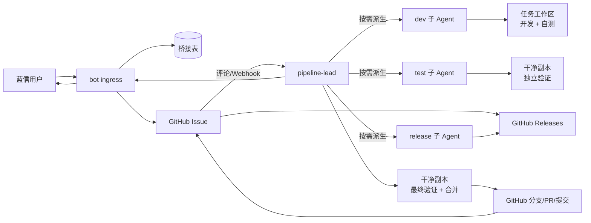

# 自动化开发-测试-发版管道 设计方案

版本：v0.7.2（Agent-first、GitHub Issue 驱动、无 GitHub Actions）  
日期：2026-11-05  
状态：待评审，作为后续实施基线  
参考平台：Syntropy Agent Cluster（仅使用对外接口，不修改平台源码）

---

## 0. 设计决策摘要

本版相对 v0.6.2 做了范围和架构收敛，核心决策如下：

1. **GitHub Issue 是工作项事实源**：问题描述、讨论、方案确认、责任人、状态标签、关联 PR 和发布批次都在 GitHub。蓝信只负责收集反馈和通知用户。
2. **内部 Issue 服务取消**：不再维护第二套 Issue CRUD 和编号。只保留一个薄桥接层，保存蓝信消息 ↔ GitHub Issue ↔ Syntropy 任务 ↔ 审批/验证证据的映射。
3. **每个 Issue 一个团队，初始只有 lead**：`pipeline-lead` 负责分诊、判断复杂度、派生、状态推进和用户沟通；需要时再派生 `dev`、`test`、`release` 子 Agent。子 Agent 默认不再派生。
4. **复杂 Issue 先讨论后开发**：在 GitHub Issue 评论区发布方案版本，由有仓库权限的维护者执行 `/approve vN`；服务端校验权限、方案版本和内容哈希后才允许派生 dev。
5. **不使用 GitHub Actions**：dev/test 子 Agent 在各自工作区开发和测试；lead 在干净副本上做最终验证、提交和合并。GitHub 只承载 Issue、评论、PR、标签和 Release 记录。
6. **Agent 决策，服务执行**：Agent 拥有流程判断权；收消息、去重、持久化、权限、补丁校验、提交、签名和审计由受控服务/工具执行。
7. **安全和不可逆操作保留门禁**：复杂 Issue 审批、主分支写权限、敏感文件扫描、发布确认和回滚不能只靠提示词约束。
8. **lead 是唯一通信接口**：所有蓝信和 GitHub 沟通由 lead 发起；子 Agent 只向 lead 汇报，桥接服务只路由入站事件，不代替 lead 创建子 Agent。
9. **集中配置**：项目、GitHub 地址、蓝信和 Syntropy 凭据统一在管理台配置；凭据加密存储，Agent 不读取明文。

---

## 1. 背景与目标

用户在蓝信群里直接提 Bug、提优化建议或上报崩溃。系统把反馈转成 GitHub Issue，由 lead Agent 判断处理方式：简单问题直接进入修复；复杂问题先在 GitHub 评论区讨论方案，确认后再进入开发；修复由 Agent 完成，lead 最终验证、提交和合并；满足发布条件的 Issue 进入每日发版。

目标：

- 用户提完问题后尽快收到 GitHub Issue 链接和当前状态。
- 简单 Bug 在无人额外介入的情况下完成修复、验证和合并。
- 复杂任务在 GitHub 留下完整方案讨论和确认记录，未经确认不进入开发。
- 每个合并都有可追溯的测试证据和环境信息。
- 每天凌晨 06:00 可以发布前一日的候选修复，09:00 用户可更新。
- 大版本仍保留全量 Story Test 和人工发布确认。

非目标（本期不做）：

- 蓝信以外的用户入口。
- 完全无人值守的高风险发布。
- 自建 CI 平台、管理看板和独立 Issue 系统。

---

## 2. 总体架构



组件职责：

| 组件 | 职责 |
|---|---|
| `bot` ingress | 蓝信消息接收、验签、去重、用户身份提取、创建任务，并把事件路由给 lead；对外通知由 lead 发起 |
| 桥接服务 | 蓝信消息 ↔ GitHub Issue ↔ Syntropy 任务映射；审批与验证证据；审计；不复制 Issue 业务 |
| 集中配置管理台 | 管理员维护项目、GitHub 地址、蓝信群绑定、验证契约和 Agent 工具权限 |
| 配置/密钥服务 | 按 project_id 解析项目并解密凭据，供工具层使用；不向 Agent 暴露 token |
| Runtime Manager | 启动守护 `syntropy-app-server` 进程；通过 Go SDK 部署 Master/Worker；通过 App Server 的 `/api/agents`、`/api/agent-templates` 部署 pipeline-lead 和同步模板；不创建子 Agent |
| GitHub App / Webhook | Issue、评论、标签、PR、Release；把评论和状态事件推给 lead |
| Syntropy Master | 任务、消息投递、Agent 生命周期、SSE 事件流 |
| `pipeline-lead` | 分诊、复杂度判断、创建子 Agent、协调、最终验证、提交、合并、对外通知；唯一通信接口 |
| `dev` 子 Agent | 复现、修改、写单测、本地构建/静态检查/单测、回传 diff |
| `test` 子 Agent（可选） | 在干净副本做独立集成/回归验证，不改业务代码 |
| `release` 子 Agent | 汇总待发版 Issue、构建制品、生成 Release Note；结果回给 lead，由 lead 发布 |
| 验证工作区 | dev/test/lead 各自独立；lead 的干净副本是合并门禁 |
| 桥接数据库 | 只存映射、审批、验证报告索引和审计，不保存完整 Issue 描述 |

不采用的组件：

- 内部 Issue CRUD 服务和第二套 Issue 编号。
- 四个常驻的 Triage/Dev/Test/Release Agent。
- 四个独立 MCP Server。
- GitHub Actions 和托管 CI 分钟数。
- MVP 阶段的管道监控看板和自定义报表；配置管理台例外，必须提供。

---

## 3. 核心设计

### 3.1 用户身份与入口

- 蓝信用户以 `lanxin_user_id` 和展示名标识；不引入 License/证书体系。
- bot 收到消息后按 `platform_message_id` 去重，提取群/私聊、发送者、文本和附件。
- 每条有效反馈创建一个 GitHub Issue，标签包含 `source:bluex`；Issue 正文记录蓝信用户标识和来源消息 ID。
- 同一用户高频重复问题按限流和相似 Issue 合并处理；合并保留原始消息记录。
- 崩溃上报按用户/设备限流；附件做大小、类型和敏感信息检查。

### 3.2 GitHub Issue 作为事实源

Issue 的标题、描述、评论、责任人、标签、关联 PR 和 Release 都以 GitHub 为准。桥接表只保存：

```text
source_message_id
chat_type / chat_id
lanxin_user_id
github_repo
github_issue_number
github_issue_url
syntropy_task_id
lead_agent_id
status_cache
last_github_event_at
created_at / updated_at
```

审批和验证附加字段：

```text
complexity            simple | complex
discussion_status     none | discussing | awaiting_approval | approved | changes_requested | rejected
plan_version
plan_hash
approval_comment_id
approved_by
approved_at
approval_checked_at
verification_report_id
```

标签建议：

| 标签 | 含义 |
|---|---|
| `source:bluex` | 来源是蓝信 |
| `smartpipe:triaging` | lead 正在分诊 |
| `smartpipe:discussing` | 复杂方案讨论中 |
| `smartpipe:awaiting-approval` | 等待维护者确认具体方案版本 |
| `smartpipe:approved` | 已批准，可以开发 |
| `smartpipe:in-dev` | dev 正在处理 |
| `smartpipe:testing` | 等待或正在执行最终验证 |
| `smartpipe:ready` | 已通过门禁，等待发版 |
| `smartpipe:blocked` | 需要人工介入 |
| `smartpipe:released` | 已发布 |
| `smartpipe:rejected` | 明确拒绝 |

标签是可视状态；审批事实以数据库中的批准记录为准。

### 3.3 Issue 状态机

```text
new
 └─► triaging
       ├─► need_info ──► triaging
       ├─► duplicate ──► 归并到目标 Issue
       ├─► simple ──► approved（策略自动放行）
       └─► complex ──► discussing ──► awaiting_approval
                                        ├─► approved
                                        ├─► changes_requested ──► discussing
                                        └─► rejected / postponed
approved ──► in_dev ──► testing ──► ready_to_ship ──► released
                 ▲             │
                 └── 失败回修 ──┘（最多 3 轮）
```

规则：

- `in_dev` 只能由服务端在批准状态校验通过后进入；lead 不能直接把状态改成 `in_dev`。
- 复杂 Issue 的方案变化后，旧批准自动失效，状态回到 `discussing`。
- 3 轮修复仍失败，进入 `blocked` 并通知人工。
- 发布失败或需要回滚时，Issue 保持 `ready` 或转为 `blocked`，不能假装已发布。

### 3.4 简单与复杂 Issue 的判断

满足任意一条即按复杂处理：

- 涉及多个模块、服务或仓库。
- 需要修改数据库结构、接口协议、权限模型或配置格式。
- 涉及安全、认证、加密、发布流程等敏感路径。
- 需要跨团队协作或外部系统改造。
- 预计实现超过 1 个工作日。
- 验收条件不清晰，存在多个可选方案。
- lead 无法判断。

不确定时默认复杂。简单 Issue 的自动放行也必须由策略服务记录依据，例如路径规则、风险扫描结果和测试要求，不能只靠 lead 声称“这个很简单”。

### 3.5 复杂 Issue 的 GitHub 讨论门禁

复杂 Issue 的完整协议见 [复杂Issue讨论与确认流程.md](复杂Issue讨论与确认流程.md)，要点：

1. lead 创建或关联 GitHub Issue，状态 `discussing`，写回桥接表。
2. lead 在评论区发布带版本号的方案（`v1`、`v2`...），包含范围、步骤、风险、回滚和验收标准。
3. 维护者使用 `/plan`、`/changes`、`/hold`、`/reject`、`/approve vN` 表达决策。
4. GitHub Webhook 把 `issue_comment` 事件推给 lead；lead 可以休眠等待，不轮询。
5. 服务端校验评论人仓库权限、是否满足 `CODEOWNERS`、方案版本和内容哈希，通过后才写入 `approved`。
6. dev 派生工具再次检查批准记录；未批准、批准版本过期或批准人权限失效时返回 `approval_required`。
7. 蓝信用户通过摘要参与讨论；lead 代发的蓝信评论不能作为批准，最终确认必须来自有 GitHub 权限的维护者。

### 3.6 Agent 团队模型

每个 Issue 创建一个任务/团队，初始只有一个 `pipeline-lead`。lead 的职责：

- 读取蓝信消息和 GitHub Issue。
- 检索重复、判断类型和复杂度。
- 创建/更新 GitHub Issue、评论和标签。
- 需要时创建 dev/test/release 子 Agent。
- 汇总子 Agent 结果，处理失败和重试。
- 在干净副本上执行最终验证、提交、合并。
- 通知蓝信用户和 GitHub 维护者。

子 Agent 按需创建，角色模板见 `configs/agents/`：

| 角色 | 输入 | 输出 | 权限 |
|---|---|---|---|
| `dev` | Issue、base_commit、代码上下文、验收标准 | patch/diff、单测、构建/lint 日志、环境信息 | 仓库只读，不能推送主分支 |
| `test` | base_commit、patch、测试范围 | 集成/回归报告、失败复现证据 | 仓库只读，不能改业务代码 |
| `release` | `ready` Issue 集合、版本规则 | 构建、制品、Release Note、发布/回滚结果 | 只能调用发版工具 |

派生规则：

- 每个 Issue 最多同时存在 3 个子 Agent。
- 只有 lead 能派生；子 Agent 默认不再派生。
- 子 Agent 设置 TTL、超时和取消机制；完成后回收。
- 派活使用 A2A `request`，必须包含目标、输入、交付物、边界、验收标准和时限；收到 `response` 后由 lead 汇总。
- 同一 Issue 的修复重试优先回到原 dev 子 Agent，保留上下文；超过 3 轮升级人工。
- lead 的最终结论必须基于子 Agent 的证据和自己在干净副本上的验证。

### 3.7 开发、测试与合并

开发阶段不依赖 GitHub Actions。详细方案见 [无GitHub-Actions的Agent开发测试方案.md](无GitHub-Actions的Agent开发测试方案.md)。

流程：

```text
approved Issue
  → dev：独立工作区，复现 → 修改 → 写测试 → build/lint/unit
  → dev 回传 base_commit + patch + 日志 + 环境
  → test（可选）：干净副本应用 patch，跑 integration/smoke
  → lead 最终门禁：
      新建干净副本
      校验 patch 可干净应用
      执行仓库验证契约中的 required_for_merge 命令
      检查 diff 大小、敏感文件、密钥、依赖变化
      检查审批状态和证据链
      通过 → 生成提交 → 合并主分支 → 推送
      失败 → 退回 dev，最多 3 轮
```

仓库通过 `smartpipe.yaml` 或 `Makefile` 固定验证命令和工具链版本，禁止 Agent 临时发明“我跑过了”。验证报告至少包含：

```json
{
  "issue": "123",
  "base_commit": "abc123",
  "patch_hash": "sha256:...",
  "commands": [
    {"name": "build", "exit_code": 0, "duration_ms": 1200},
    {"name": "unit", "exit_code": 0, "duration_ms": 8400}
  ],
  "toolchain": {"go": "1.24.3"},
  "verified_by": "pipeline-lead",
  "started_at": "...",
  "finished_at": "..."
}
```

权限与合并：

- 只有 lead 拥有主分支写权限；dev/test 只读。
- lead 在 `agent/<issue-number>` 分支生成提交，再合并主分支。
- 禁止 force push 主分支；禁止 dev/test 直接推送。
- 提交信息关联 Issue，例如 `fix(#123): handle empty export response`。
- 没有 Actions 时，可通过桥接服务创建 `smartpipe/verify` GitHub Check Run，或使用 `smartpipe:verified` 标签和评论摘要作为可见证据。

### 3.8 每日发版

06:00 由 Syntropy Automation 触发 release 任务：

```text
06:00 Automation
  → release lead 读取 smartpipe:ready 的 Issue 集合
  → 生成 Release Note（修复/优化/新功能 + 蓝信贡献者致谢）
  → 在本地/自托管环境执行完整测试和构建
  → 打版本号 x.y.N，签名（如需要）
  → 创建 GitHub Release / tag，上传制品
  → 发布验证和升级冒烟
  → 成功：回写 released 标签，蓝信通知
  → 失败：保留制品和日志，回滚候选，通知在岗工程师
```

Automation 的 `succeeded` 只表示会话启动，不能当作发布成功。发布门禁由 release 任务和发版工具判定。大版本（x.y）仍必须跑全量 Story Test 和人工确认。

### 3.9 崩溃上报

崩溃能力作为 M2 扩展：

- 客户端采集环境快照、调用栈、最近日志，生成脱敏的 `crash_bundle`。
- 蓝信一键上报后，bot 校验大小、类型和频率，lead 创建 `crash_report` 类型 Issue。
- lead 结合崩溃栈和代码上下文判断模块；复杂修复同样走讨论门禁。
- 原始包按 Issue 保留期清理；不把用户文件正文和敏感 token 放进 Issue。

### 3.10 通知与反馈闭环

| 事件 | 蓝信反馈 |
|---|---|
| Issue 创建 | GitHub Issue 链接、编号、当前状态 |
| 需要补充 | 模板化追问，最多 2 轮 |
| 复杂讨论 | 讨论链接、当前待确认问题和方案摘要 |
| 进入开发 | 预计处理时间 |
| 验证失败/转人工 | 失败原因和人工介入提示 |
| 合并/待发版 | 修复说明、目标版本、预计 06:00 发版 |
| 发布完成 | Release Note、升级提示 |
| 回滚 | 回滚原因和后续处理 |

---

### 3.11 集中配置与唯一通信接口

**lead 是系统通信的唯一接口**：

- 所有蓝信回复、GitHub Issue/评论/标签、发布通知都由 lead 发起。
- 子 Agent 只向 lead 回传 diff、测试报告、制品和发布结果；默认不挂载 GitHub/蓝信外部通信工具。
- 桥接服务只接收 webhook、去重、解析项目和把事件路由给 lead，不直接创建子 Agent，也不代替 lead 对外沟通。
- 我们的代码不调用 Agent 创建接口；pipeline-lead 自己使用 Syntropy 的 Agent 管理和 A2A 工具创建干活的子 Agent。

**集中配置管理台**：

- 项目注册表：项目名、GitHub provider、仓库地址、默认分支、Issue 仓库、标签前缀、CODEOWNERS/审批人、验证契约路径、发版配置、蓝信群绑定。
- 凭据管理：GitHub App、GitHub Webhook secret、蓝信 App ID/Secret/API Base、Syntropy Master URL/service token、Git 凭据、发版签名密钥。
- 连接测试：GitHub 安装状态、蓝信 token、Syntropy 可达性、Git 只读 clone；测试结果不回显密钥。
- 凭据使用 AES-GCM/KMS 加密存储；管理台只显示掩码和最后 4 位；Agent 只传 project_id，由工具层解析凭据。
- 项目解析：蓝信群/会话绑定到项目；GitHub Webhook 按 installation + repo 解析项目；找不到时拒绝或转人工，不猜测。

完整字段、API 和安全要求见 [集中配置管理台设计.md](集中配置管理台设计.md)。

### 3.12 Syntropy 运行时管理

配置管理台通过 Runtime Manager 管理 Syntropy 运行时。对照当前源码（`D:\qax\reagent\dev\git\Syntropy`），三层能力边界不同：

- **App Server 是进程**：`syntropy-app-server` 由 Runtime Manager 自己启动和守护，传入 `--server-addr`、节点/数据/日志目录和临时 token；Go SDK 只是它的客户端（`Options.BaseURL` 默认 `http://127.0.0.1:8765`），不负责启动进程。
- **Master/Worker 走 Go SDK**：`Master.Deploy` / `DeployStatus` / `Registry` / `Activate`，`Nodes.Deploy` / `Ensure` / `Progress` / `Ping` / `Delete` / `Redeploy` 均已公开，可直接调用并展示进度。
- **pipeline-lead 走 Agent API**：通过 App Server 的 `POST /api/agents`（`DeployAgent(AgentSpec)`）创建，返回 `AgentOperation`，再轮询 `/api/agent-operations/{id}`；模板用 `/api/agent-templates` 同步。当前 Go SDK 没有 Agents / AgentTemplates 分组，Runtime Manager 用 HTTP adapter 补齐。
- 对 App Server 做启动、停止、重启和健康检查；对节点做部署、drain 和回收；对 lead 做 desired-state 切换、重启和回收。
- Runtime Manager 只管理 App Server 进程、Master/Worker 节点和 pipeline-lead 部署；子 Agent 仍由 lead 自己创建，蓝信/GitHub 通信仍由 lead 发起。
- service token、join token 和 Git 凭据只在服务端使用；浏览器不接触明文，节点注册命令只展示一次。

详细页面、字段、API 和验收用例见 [Syntropy运行时管理设计.md](Syntropy运行时管理设计.md)。

---

## 4. 关键时序

### 4.1 简单 Bug

```text
用户 → bot ingress → GitHub Issue（source:bluex）
  → lead 分诊，策略放行
  → dev 修复并自测
  → lead 干净副本验证
  → lead 提交、合并
  → 蓝信通知 Issue 和预计发版时间
```

### 4.2 复杂 Issue

```text
lead 判断复杂
  → GitHub Issue 标签 discussing
  → lead 发布方案 v1
  → 维护者评论讨论
  → /changes v1 → lead 发布 v2
  → /approve v2 → 服务端校验 → approved
  → dev 修复 → lead 最终验证 → 合并
  → 蓝信同步讨论结论和发版时间
```

### 4.3 崩溃上报

```text
客户端崩溃 → crash_bundle → 蓝信一键上报
  → bot 校验 → lead 建 crash_report Issue
  → lead 定位模块 → 复杂则讨论，简单则 dev
  → 修复 → lead 验证 → 合并 → 发版通知
```

---

## 5. 安全与权限

- **GitHub App 最小权限**：Issues 读写、Issue comments 读写、Metadata 读、Contents 读；创建分支/PR 的可信身份才需要 Contents 写和 Pull requests 写；不需要 Actions 权限。
- **凭据集中托管**：所有 GitHub/蓝信/Syntropy 凭据在管理台加密保存，工具层按 project_id 解密；禁止写入 Agent 提示词、任务消息、仓库或日志。
- **唯一通信接口**：只有 lead 能调用蓝信/GitHub 外部通信工具；子 Agent 的工具权限不包含这些能力。
- **运行时操作**：App Server 启停由 Runtime Manager 管理进程，Master/Worker 生命周期经 Go SDK，lead 部署经 App Server 的 `/api/agents`；高影响操作二次确认并审计。
- **仓库权限**：dev/test 只读；只有 lead/桥接的可信身份能写主分支；主分支禁止 force push、禁止删除、禁止直接推送绕过。
- **复杂 Issue 审批**：评论人必须是仓库维护者，满足 CODEOWNERS；批准绑定方案版本和哈希，方案变化自动失效。
- **补丁安全**：base_commit 绑定、干净应用、大小限制、敏感文件/密钥扫描；不合规直接拒绝转人工。
- **测试安全**：真实依赖和凭据只放在受控测试环境，不进入 Agent 提示词或仓库；日志做脱敏。
- **审计**：每次创建 Issue、评论、派生、验证、提交、合并、发版都记录 `trace_id` / `issue_id` / `task_id` / `agent_id`。
- **防滥用**：蓝信消息和崩溃上报按用户/设备限流；重复问题归并；附件大小和类型校验。
- **发布制品**：签名（如需要）只由发版工具完成；客户端只接受有效签名。

---

## 6. 可观测性与指标

| 指标 | 目标 |
|---|---|
| Issue 首次响应时间 | < 5 分钟 |
| 20 个样例归档准确率 | ≥ 90% |
| 自动修复一次通过率 | ≥ 70% |
| 复杂 Issue 未审批进入开发 | 0 |
| 合并前最终验证覆盖率 | 100% |
| 5 个历史 Bug 端到端修复 | 5/5 |
| 每日发版成功率 | ≥ 95% |
| 发布后 48h 新崩溃回归 | < 5% |

状态查询以 GitHub 标签和桥接表为准；智能体运行层面的事件从 Syntropy SSE 补充。MVP 阶段不建独立看板，先用 GitHub Issues/Projects 和日志查询。

---

## 7. 实施路线图

| 阶段 | 范围 | 验收 |
|---|---|---|
| M0：配置管理台、项目注册与运行时管理 | 项目注册、GitHub 地址、蓝信绑定、凭据托管、连接测试、Runtime Manager（App Server 进程、SDK 管节点、Agent API 管 lead） | 管理员可新增项目、测试连接；页面能启动 App Server 进程、用 SDK 部署 Master/Worker、用 `/api/agents` 部署一条 pipeline-lead；Agent 看不到 token |
| M1：入口与 Issue 闭环 | 蓝信 bot、桥接表、GitHub App/Webhook、单 lead、Issue 创建/评论/标签、蓝信回复 | 20 个样例归档准确率 ≥ 90%；重复消息不重复建单；每个 Issue 可追踪 |
| M2：简单修复闭环 | lead 派生 dev、patch 回传、lead 干净副本验证、提交/合并 | 1 个真实 Bug 完成 Issue → dev → 验证 → 合并；无 Actions |
| M3：复杂 Issue 与独立测试 | GitHub 评论讨论、`/approve vN` 审批门禁、可选 test 子 Agent | 5 个历史 Bug 或一个复杂 Issue 走完讨论确认和端到端修复；未审批时无法派生 dev |
| M4：每日发版 | release 子 Agent、Release Note、GitHub Release、回滚 | 连续 5 个工作日发版成功，完成 1 次故障回滚演练 |
| P1：崩溃上报 | crash_bundle、自动建单、限流、脱敏 | 10 类模拟崩溃定位准确率 ≥ 80% |
| P2：经验沉淀 | 相似修复检索、蓝信用户与 GitHub 身份映射 | 命中率可量化 |

建议先完成 M1 和 M2，再投入复杂审批和发版；不要提前扩展服务数量。

---

## 8. 主要风险与对策

| 风险 | 对策 |
|---|---|
| 本地测试与生产环境漂移 | 固定工具链、lockfile、容器化、干净副本、记录环境差异；环境起不来标记 blocked |
| lead 误合并 | 最终验证工具检查审批、patch hash、测试报告和敏感文件；主分支只给 lead 写权限；保留回滚 |
| 复杂 Issue 被绕过审批 | 开发工具检查批准记录；方案版本/哈希绑定；服务端权限校验；审计 |
| GitHub API 限流或不可用 | 事件入队重试；状态保持等待；不自动批准、不自动开发 |
| Agent 失控派生 | 每个 Issue 最多 3 个子 Agent；只允许 lead 派生；TTL、超时、取消 |
| 代码或密钥外泄 | 仓库凭据只读；测试凭据不进 Agent；补丁扫描；日志脱敏 |
| 无 GitHub Actions 检查状态 | 桥接服务创建 Check Run，或使用 verified 标签 + 评论证据；分支保护配合 |
| 蓝信用户没有 GitHub 身份 | 机器人代建 Issue；维护者负责最终确认；蓝信评论只做转述 |
| 成本与并发 | 简单任务由 lead 直接处理，复杂任务才派生；限制并发和 token/时间预算 |

---

## 9. 与 Syntropy 平台的集成

### 9.1 使用的平台能力

| 能力 | 用途 |
|---|---|
| REST/SSE 任务接口 | 建任务、投消息、订阅事件、断线续传 |
| Agent 管理 | 创建 lead 和按需子 Agent，注入角色指令和 MCP 清单 |
| A2A request/response | lead 向子 Agent 派活并等待结果；禁止轮询 |
| Automation | 每日 06:00 触发 release 任务；不作为业务门禁 |
| MCP | 把 GitHub/Issue、patch、verify、release 工具暴露给 Agent |
| Blackboard | 同一编队内可选的共享便签；业务事实仍在 GitHub/桥接库 |

### 9.2 平台缺口

| 缺口 | 影响 | 补偿 |
|---|---|---|
| G1 无 headless 运行形态 | 驱动依赖桌面 sidecar | 内网常驻部署，不依赖桌面在线 |
| G2 无正式服务令牌 | 外部系统认证受限 | 内网 + 主机访问控制过渡，跟踪上游服务凭据 |
| G3 任务终态事件弱 | 不能只靠任务结束判断成功 | SSE 事件 + 子 Agent 主动回报 + 桥接状态 |
| G4 Automation succeeded 语义弱 | 不能当发布门禁 | 发布结果由 release 工具和任务结果判定 |
| G5/G6 SDK 未发布 | 集成成本高 | 复用 `api/client` 或 REST+SSE |

### 9.3 Agent 与工具的边界

Agent 负责语义判断、任务拆分、代码修改和失败解释；服务负责：

- 蓝信验签、去重、用户标识；
- GitHub Issue/评论/标签的受控写入；
- 审批权限校验和方案版本校验；
- 补丁应用、敏感文件扫描；
- 测试执行环境和证据保存；
- 主分支提交/合并的权限控制；
- 制品签名、发布和回滚。

---

## 10. 技术选型

| 组件 | 选型 | 说明 |
|---|---|---|
| 桥接服务 / bot | Go + Iris | 复用现有代码和 Syntropy `api/client` 的集成经验；Iris 已在当前仓库使用 |
| 集中配置管理台 | React + TypeScript + Vite | 项目注册、凭据管理、连接测试和审计；MVP 必须提供，不做管道看板 |
| 配置/密钥服务 | Go + 加密存储 | 凭据加密、项目解析、按工具请求注入；不向 Agent 返回明文 |
| Runtime Manager | Go + 进程管理 + Go SDK + HTTP adapter | 启动守护 `syntropy-app-server`；Go SDK 管 Master/Worker；HTTP 调 `/api/agents`、`/api/agent-templates` 管 pipeline-lead；异步操作和审计 |
| Agent 运行时 | Syntropy | 不修改平台源码，只通过 REST/SSE、Agent 管理、A2A、MCP 使用 |
| 工作项 | GitHub Issues | 唯一 Issue 事实源；不再自建 Issue CRUD |
| 代码协作 | GitHub 分支/PR/提交 | PR 承载 diff、评论和合并记录 |
| 测试 | 本地/自托管验证 | 不依赖 GitHub Actions；仓库内 `smartpipe.yaml`/`Makefile` 固定命令 |
| 发布 | GitHub Releases + 发版工具 | tag、Release Note、制品上传；需要签名时由发版工具执行 |
| 数据库 | PostgreSQL（MVP 可用 SQLite） | 只存桥接映射、审批和验证索引；不复制 Issue 内容 |
| MCP | 一个 `smartpipe-mcp` | 内部按 GitHub/issue/patch/verify/release 分组；MVP 不拆多个服务 |
| 前端 | 仅做配置管理台 | 管道监控看板暂不做；配置台是基础设施，不是业务看板 |
| 缓存/队列 | 先不用 Redis | 幂等和事件重试先落数据库；规模上来再引入 |

---

## 11. 待确认事项

1. GitHub 私有仓库地址、GitHub App 创建权限和 Webhook 配置。
2. lead 在 Syntropy 中是否能创建子 Agent、发送 A2A request 并收到 response；如果不支持，降级为固定角色模板 + A2A。
3. 复杂 Issue 的审批人范围：仓库维护者、CODEOWNERS 或指定团队。
4. lead 最终验证使用的干净机器/容器环境，以及能否运行集成测试依赖。
5. 主分支保护方式：GitHub Check Run、`smartpipe:verified` 标签，或仅依赖 lead 写权限。
6. 发版制品签名和部署方式；是否需要人工发布确认。
7. 崩溃上报客户端由哪个产品/团队实现，以及数据脱敏和保留期。
8. 是否需要蓝信用户 ↔ GitHub 账号映射；MVP 默认机器人代建 Issue。
9. 管理台登录方式：Syntropy 登录态、企业 SSO 或本地管理员账号。
10. 凭据加密使用数据库 AES-GCM 还是企业 KMS；主密钥的托管和轮换方式。
11. 多项目默认路由：未绑定蓝信群时拒绝、转人工还是落到默认项目。
12. App Server 的 headless 常驻形态与服务令牌仍属平台缺口；Runtime Manager 过渡期用进程管理 + 内网访问控制 + 临时 token，是否要求上游补正式服务凭据待定。
13. join token 的生成、有效期和 Worker 注册方式。
14. 是否给 Go SDK 补 Agents / AgentTemplates 封装；补齐前 Runtime Manager 用 HTTP adapter 直连 `/api/agents` 和 `/api/agent-templates`。

---

## 12. 文档索引

- [GitHub Issue 驱动架构](GitHub-Issue驱动架构.md)：总体定位和组件收敛说明。
- [复杂 Issue 讨论与确认流程](复杂Issue讨论与确认流程.md)：方案版本、评论命令、审批校验和验收用例。
- [无 GitHub Actions 的 Agent 开发测试方案](无GitHub-Actions的Agent开发测试方案.md)：本地验证、lead 合并、证据和权限。
- [集中配置管理台设计](集中配置管理台设计.md)：项目注册、凭据托管、连接测试和管理台 API。
- [Syntropy 运行时管理设计](Syntropy运行时管理设计.md)：App Server、Master/Worker 节点、pipeline-lead 生命周期管理。
- [下一步工作计划](下一步工作计划.md)：按周拆分的落地任务。
- [开发计划与测试环境方案](开发计划与测试环境方案.md)：15 个功能块的任务分解、测试用例矩阵与开发/测试环境清单。

本方案取代 v0.6.2 中“Orchestrator 状态机 + 四个常驻 Agent + 内部 Issue 服务 + GitHub Actions 权威测试”的相关设计。

v0.7.2 修正（对照 Syntropy 源码）：Go SDK 是 App Server 的客户端，App Server 进程由 Runtime Manager 启动；Master/Worker 用 Go SDK，pipeline-lead 用 App Server 的 `/api/agents` 部署。
